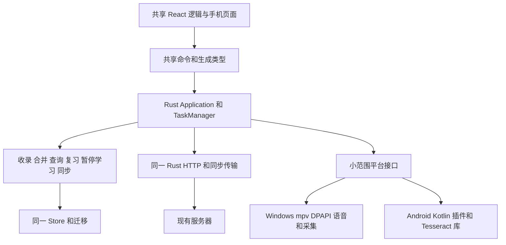

# SubtitleVocabularyList Android 架构与开发设计

| 项目 | 内容 |
| --- | --- |
| 文档编号 | DOC-ARC-ANDROID-001 |
| 文档版本 | 0.12 |
| 更新日期 | 2026-10-23 |
| 状态 | 独立运行与共享核心架构已确认；P0 与 0.26.0 P1 已接入，正常结果见专项记录；服务及未测条件另列 |
| 依据 | [Android PRD](../requirements/android-PRD.md)、[Windows 架构](architecture.md)、[数据模型](data-model.md)、[同步设计](synchronization.md) |
| 配套 | [开发指南](../development/android-development.md)、[开发计划](../planning/android-development-plan.md) |
| 源码基线 | 0.16.10，`85977d5`；下面“现状”来自源码检查，“目标”与拟增路径属于后续实现 |

## 1 设计目标与总体决策

Android 和 Windows 共用同一仓库、Rust 业务核心、数据库迁移、同步契约和 TypeScript 类型。Android 继续使用 Tauri 2 与 React，增加手机布局及必要 Kotlin 原生适配。业务变化优先修改共享代码，不复制一份手机词库、复习算法或 HTTP 同步实现。

| 决策 | 本轮采用的设计 | 维护原因与验证边界 |
| --- | --- | --- |
| AND-ADR-01 | 单仓库、单 Rust 业务库；保留 `src-tauri` 路径和已有核心 crate 名称 | 现有脚本、迁移与测试继续可用，首期不做全仓拆分或多 crate 重构 |
| AND-ADR-02 | Tauri 2＋React；手机独立导航与布局，共享查询、收录、复习及任务逻辑 | 复用已有通信及生成类型；桌面侧栏与窗口布局不直接套到手机 |
| AND-ADR-03 | Android 原生能力集中为一个本仓库 Tauri 插件，Rust 调用 Kotlin | 使用官方移动插件机制，不另维护业务 JNI／HTTP 服务；桥接可用性待 AND-M-01 验证 |
| AND-ADR-04 | 两端共用 `Store`、SQLite 迁移、收录／合并、复习、同步及查询核心 | Kotlin 不直接写个人数据库，不引入 Room 作为第二个业务存储层 |
| AND-ADR-05 | 同步 HTTP、分片、差量和连接状态编排移出 Windows 限定；凭据加密与浏览器打开保留平台适配 | 当前这些模块被条件编译遮住，不意味着逻辑本身必须重写 |
| AND-ADR-06 | Android 采用 Media3 ExoPlayer 播放、Transformer 截取原声；Windows 保持 mpv | 手机复用来源、字幕对齐、学习上下文、进度、收录与计时规则；播放解码交由平台库，最低格式集在 AND-M-05 核实 |
| AND-ADR-07 | OCR 优先复用桌面固定 Tesseract／Leptonica 源码及英语数据，Android 以 NDK 库调用 | 复用资源、文字处理和许可清单；不运行桌面 EXE，不引入另一套云 OCR；Android 固定源码构建与正常图片／暂停帧识别已验证，见验证记录 |
| AND-ADR-08 | 凭据使用 Android Keystore 密钥加密后保存在应用私有目录；Windows DPAPI 保持 | 共享凭据结构与账号边界，平台只负责安全保存，不把令牌交给 React |
| AND-ADR-09 | 首期工程目标 Android 10／API 29 及以上、arm64；本地开发优先连接一台真实设备 | 是实施起点，未声称已兼容。模拟器 ABI 只在实际需要时增加，不自动做兼容矩阵 |
| AND-ADR-10 | 不新增手机服务器；已授权 P1 继续使用现有复习／独立测试历史协议 | 控制维护面；版本、测试和手动发布仍按项目规则执行 |

Tauri 官方提供 Rust 与 Kotlin 的移动插件桥接；Android SDK 的文件、媒体及系统语音由插件封装。上述组合为本项目选型，尚不是当前工程已经可运行的事实。[Tauri 移动插件文档](https://v2.tauri.app/develop/plugins/develop-mobile/)

### 1.1 运行拓扑

正式客户端的唯一跨端资料通道为“Android ↔ 现有服务器 ↔ Windows”。两台设备不直连，不要求同网，不依赖另一台开机。共享源码分别编译到两端，Android 自带自己的 OCR 引擎／英语资源并使用手机私有数据库。手机不调用桌面回环／局域网模型服务；开发期 USB 调试与 Vite 连接不属于正式运行拓扑。

### 1.2 逐阶段实施边界（0.17.0–0.22.0）

共享命令已抽取到 `src-tauri/src/host/commands`，由唯一 catalog 按平台注册。Android 工程位于 `src-tauri/gen/android`，原生能力集中在 Kotlin `MobilePlatformPlugin` 与 Rust `mobile_platform.rs`，现阶段直接维护于应用工程，避免为了一个适配器增加独立仓库或插件 crate。

词典来自桌面同一资源清单，构建时校验并编入 assets，首次手机启动时由后台线程安装到私有 files 目录；完成后 Store 通过受锁保护的词库引用重新载入。手机界面等待资源准备后提供查询。Windows 仍走原资料目录和启动流程；跨设备资料交换保持服务器拓扑。完整 debug 构建和 Windows 隔离启动通过，手机实际安装／查询、同步、媒体及 OCR 的完成状态见 [Android 验证记录](../testing/android-results.md)。

0.17.1 增加共享 `HostStartup`，手机先等待 `app_ready` 再读应用状态，避免 WebView 先加载时访问未注册状态。Android 原生视图负责系统栏和键盘 Insets；真机升级冷启动、资料保持与键盘适配现已通过。

0.18.0 将 `credentials`、`site_connection`、`sync_http`、`sync_transport` 接到两端同一命令表。平台差异仅在 DPAPI／Keystore 和系统浏览器；同步完整资料、原声、差量、回执与水平测试历史保持原实现。`device_sync.rs` 只维护手机本机偏好、明确资料归属及上次完成时间，不建立第二个同步协议。手机共用 `SyncView` 的批准、冲突核对和保留历史入口，没有增加 P1 测试创建功能。

## 2 已核对的复用边界

| 现有代码 | 现状与改造点 | 处理方式 |
| --- | --- | --- |
| `store.rs`、`migrations/001…010` | 已有 SQLite、WAL、关联及升级；当前 schema 10 | 原样复用业务语义；P1 表可保留，不为手机另建缩减 schema |
| `vocabulary.rs`、`sync_merge.rs` | 已有规范化、三类收录、关联、历史和幂等 | 共享同一实现；手机输入先转换为现有 CollectionInput |
| `reviews.rs`、`review_policy.rs` | 双维度作答、修正、排程、专项核心可复用 | 只替换音频准备／播放，Kotlin 不判分、不计算到期 |
| `synchronization.rs`、`sync_data.rs`、`sync_delta.rs`、`sync_limits.rs` | 业务同步核心与协议不依赖 Windows UI | 保持完整资料、回执、差量基准及容量规则 |
| `sync_http.rs`、`sync_transport.rs` | 在 `lib.rs` 中被 Windows＋desktop 条件限制；HTTP 使用 Rust reqwest | 移到共享宿主可编译范围，注入凭据访问，不在 Kotlin 重写网络协议 |
| `site_connection.rs` | 站点地址校验通用，连接编排包在 Windows 子模块，混用 DPAPI 与打开浏览器 | 提取共享连接编排，浏览器／凭据改调平台服务 |
| `application.rs`、`providers.rs` | 设置校验只接受模型回环地址，查询服务凭据的非 Windows 路径直接报错 | 区分平台设置与服务访问策略，补手机凭据实现；不能只改一个地址绕过现有规则 |
| `explanations.rs`、`queries.rs`、`query_stream.rs`、`base_dictionary.rs` | 缓存、底库、模型并发及流式解析可复用 | 保留字词与整句分工，手机不自动启动整集后台准备 |
| `watch.rs`、`playback.rs`、`subtitles.rs` | 有共享进度、上下文、自动收录、DisplayClock；部分入口仍要求真实文件路径及 MediaTools | 拆开文件／引擎操作与纯规则；保留自动收录去重和双语时间对齐 |
| `media.rs`、`ocr.rs` | 字幕／OCR 结果处理与 ffmpeg、Tesseract CLI、Whisper 子进程调用混在模块内 | 提取 Segment、SRT 解析、裁剪坐标与结果处理；桌面命令行调用留 Windows 路径，手机用库接口 |
| `desktop/commands/*`、`ipc_dto.rs`、`ipc_export.rs` | CRUD 可共享，但部分同文件命令导入 Windows 语音／播放类型；类型导出依赖 desktop 特性 | 按函数实际依赖抽取共享命令和 DTO，平台命令单独注册，维持一个生成类型入口 |
| `desktop.rs`、`windows_native.rs`、`player/*`、`credentials.rs`、`autostart.rs` | Windows 窗口、mpv／HWND、采集、语音、DPAPI、托盘 | 保留 Windows 实现；Android 只实现同一业务所需的平台接口 |
| `src/api.ts`、`generated/ipc.ts`、收录／任务／复习组件 | 已有类型化 invoke 与状态处理；部分媒体使用 convertFileSrc | 复用调用层、数据模型和状态逻辑；媒体播放按能力适配，手机导航及详情布局单独组织 |

以上来自[核心导出](../../src-tauri/src/lib.rs)、[Application](../../src-tauri/src/application.rs)、[媒体处理](../../src-tauri/src/media.rs)、[同步 HTTP](../../src-tauri/src/sync_http.rs)、[服务凭据](../../src-tauri/src/providers.rs)与[类型生成脚本](../../scripts/check-commands.mjs)。不预设代码复用百分比，按“业务规则是否仍有唯一实现”验收。

## 3 模块和代码组织

| 模块编号 | 拟增／调整位置 | 职责与需求 |
| --- | --- | --- |
| AND-ARC-01 | `src/mobile/`，共享组件与 hooks 保留在现有 `src/` | 四项手机导航、列表详情、收录面板；AND-FR-01、02、12、13、16 |
| AND-ARC-02 | `src-tauri/src/host/commands/`、`host/mod.rs` | 两端共用命令、任务事件、DTO 及能力快照；所有 P0 的通信入口 |
| AND-ARC-03 | 现有 Rust 业务模块与 migrations | 唯一数据、合并、复习、同步事实；AND-FR-01 至 05、11 至 14 |
| AND-ARC-04 | `src-tauri/src/platform/`，保留现有 Windows 实现 | 凭据、文件访问、音频／图像平台入口，避免业务模块散布 JNI 调用 |
| AND-ARC-05 | `plugins/svl-android/` | Tauri 插件 Rust 壳＋Kotlin，文件／Intent、Media3、语音、生命周期、Keystore；AND-FR-04、06 至 11、15、16 |
| AND-ARC-06 | 现有 sync／site_connection 模块 | 共用认证编排、完整推拉、差量和媒体；AND-FR-14、15 |
| AND-ARC-07 | `src-tauri/src/ocr/` 与固定原生资源构建入口 | Tesseract C API 的小范围封装，复用识别后处理；AND-FR-07、10 |
| AND-ARC-08 | `src-tauri/gen/android/`、Android 平台配置、拟增开发脚本 | Android Studio 工程、依赖锁定、开发运行；AND-NFR-06、07 |

这些路径是目标结构，按使用需要建立，不先创建空目录。暂不拆独立核心 crate；如果实际出现第二个独立原生宿主或明确依赖负担，再据证据讨论拆分。

### 3.1 Cargo 特性与命令注册

目标特性分为 `app-host`（Tauri 共用宿主）、`desktop`（Windows 宿主能力）、`mobile`（Android 插件）和 `ipc-types`（类型导出）。默认只启用 `app-host`；Windows 平台配置显式启用 `desktop`，Android 配置启用 `mobile`。原生核心检查仍可 `--no-default-features`。平台 crate 依赖放到相应 target 配置，不把 Windows 插件编入 Android。

同时修改 `build.rs` 的宿主条件、`lib.rs` 的 run／模块条件、Windows 命令行 bin 所需特性和现有启动脚本，保持三个 `desktop:*` 用户入口行为。Windows 原生源码导出／检查显式带所需特性；Android 的库入口使用 Tauri mobile_entry_point。不能只删除 `cfg(windows)`：`desktop.rs` 顶层仍导入 Windows 采集与托盘类型。

本机 Tauri CLI 2.12.1 的 Android dev／build 帮助未提供 `--no-default-features`。因此不编造该 CLI 参数，也不向 Gradle 拼接未支持的 Cargo 参数；特性组合由上述配置实现。`ipc-types` 应从 Windows 窗口初始化中分离，统一导出共享命令和平台命令 DTO，运行时再按能力隐藏不支持操作。

### 3.2 受控 Android 工程与生成目录

当前 `.gitignore` 排除了整个 `src-tauri/gen/`。初始化后需调整为跟踪 Android 工程必要的 Gradle wrapper、manifest、资源、配置和少量宿主扩展，继续忽略 build、`.gradle`、local.properties、签名材料和产物。插件源代码放 `plugins/svl-android/`，减少对生成 Activity 的直接修改；初始化不覆盖已经维护的工程。

Tauri 基础配置提取共用项，NSIS、WebView2、Windows 工具资源及窗口偏好移入 Windows 配置；Android 配置不继承桌面资源包。`package.json` 仍是应用版本唯一来源，Android versionName 随之生成；versionCode 的单调映射由初始化阶段定稿并纳入版本检查，不手填另一套应用版本。

## 4 数据、文件与任务

### 4.1 唯一数据层

应用根目录取 Android 应用私有 files 目录，再交给现有 Store。个人 SQLite、独立原声、词典及可恢复任务资料放持久目录；临时图片、导出中间文件和可重建音频放 cache／jobs 并区分用途。系统 cache 不能保存个人原声或已确认事实。

迁移继续集中在同一 migrations 链。仅本机的 URI 映射、手机设置与播放定位可使用既有 settings 的独立键，不为平台偏好增加业务表。必须新增共享业务字段时采用兼容迁移，并同步类型、协议与桌面读取；P0 不因改为手机而自动改变完整同步结构。

### 4.2 媒体引用

拟采用 `MediaRef` 作为宿主输入：`id` 为本机不透明标识，包含显示名、类型与授权状态；Android 的 content URI 保存在私有映射中，Windows 旧路径通过适配器转换。它不是可同步来源标识，也不是把 URI 塞进 PathBuf 后交给 std::fs。

视频使用系统选择器与可持久化的读取授权，不默认复制完整大文件。临时分享 URI 如需稍后使用，按实际授权复制所需图片／字幕到受控目录；视频只有确需导入且用户知晓时才复制。授予的文件描述符必须定义所有权与关闭责任，seekable 与非 seekable 输入分别处理；无法定位的输入不能冒充可靠字幕／音频区间。

个人收录所需字幕原文、来源指纹和原声由 Rust 管理。文件内容摘要在后台按流计算，用于同源匹配；未完成指纹／字幕索引时可播放，但不构造会变化的自动收录标识。URI、绝对路径及未收录整集文本不进入现有词条同步包；AND-FR-22 的已准备剧集资料使用独立版本契约，见第 7 节。

### 4.3 异步与保存

SQLite、散列、网络与 OCR 不运行在 WebView／Android UI 线程。平台媒体任务在相应工作线程执行，只有播放器控件和 Activity 操作切到主线程。Rust 调平台期间不持有业务数据库锁；也不在 Android 主线程等待 Rust 再回调主线程。

媒体先输出到本机临时文件并校验，再由共享持久化流程登记摘要、格式、时长与关联；提交成功后才能显示已保存。保留已有操作标识、任务取消与恢复语义，不新增 Android 专用“保存成功”旁路。下载和导出完成的旧结果须再次核对当前操作；长任务使用 TaskManager 返回句柄，不靠一次跨桥接阻塞等待无限时长。

## 5 平台接口与事件草案

以下表格保留初始设计编号；当前实际入口见本节末，其余仍为设计契约。共享 CRUD、收录、测验与同步命令优先沿用现有名字及 DTO；新增内容由同一 Rust 类型生成工具输出到 TypeScript。Kotlin 只维护平台输入／输出 DTO，不复制 Entry、ReviewState 等完整业务模型。

| 编号 | 接口／事件草案 | 输入与输出边界 |
| --- | --- | --- |
| AND-IF-01 | `app_capabilities` | 返回 platform、可用文件／播放／OCR／声音及当前不支持的命令；不泄露凭据 |
| AND-IF-02 | 平台 `pick_media`／`read_document` | 返回 MediaRef 或受控临时文件标识；授权、取消及生命周期明确，不接受任意外部传入磁盘路径 |
| AND-IF-03 | `external_input_received` | operationId、文本或图片引用、可取得的来源；先入待处理队列，冷／热启动同路，确认才收录 |
| AND-IF-04 | 播放 `open`／`control`／`snapshot` | MediaRef、播放会话与控制意图；返回引擎实际状态、位置、稳定轨道键和序号 |
| AND-IF-05 | `subtitle_cues`／`subtitle_index_ready` | 当前媒体／轨道版本、起止时间、文本、时间精度；交给共享字幕对齐与上下文处理 |
| AND-IF-06 | `learning_content_visible` | 会话、上下文 revision、有效译文摘要与实际显示确认；共享 DisplayClock 据此计时 |
| AND-IF-07 | `capture_frame`／`ocr_start` | 当前暂停 revision、选区；返回受控图像及实际位置／尺寸，OCR 返回文字和坐标，不虚构对白时间 |
| AND-IF-08 | `extract_audio` | 稳定来源、所选音轨、起止区间、操作标识；返回临时文件、实际区间和格式，经 Rust 验证登记 |
| AND-IF-09 | `speech_voices`／`speech_prepare`／播放 | 仅显示可用离线声音，合成输出标为生成语音；准备成功后共享核心才记录题目可播放 |
| AND-IF-10 | 原生私有 `credential_load/save/delete`、`open_authorization` | Rust 使用同一凭据结构，Keystore 或 DPAPI 负责保存；React 无令牌读取权限 |
| AND-IF-11 | `app_lifecycle_changed`／音频焦点变化 | Rust 取消旧暂停计时、保存位置、处理待任务；不把内部暂停当作主动学习 |

现有 AppError、TaskHandle 与 task_updated 保持为共用返回机制。事件包含 sessionId／revision／sequence，接收端丢弃旧会话结果；重开页面先读取当前快照，再订阅增量。这里只统一实际需要的窄接口，不建设任意消息总线或插件运行框架。

0.20.0 本轮已接入 `video_pick/library/open/state/control/viewport`、`video_index_start/study/context/subtitle_add` 与共享 `preview_start`。系统选择器采用 ACTION_OPEN_DOCUMENT 并持久保存读取授权；MediaRef 只留在本机。Kotlin 仅实现系统授权、Media3 解码／解析／导出，Rust 继续负责来源、字幕资产、Corpus、片段摘要登记及收录事务。实际验证结论以 Android 增量记录为准。

## 6 播放、字幕与暂停学习

### 6.1 手机播放宿主

采用 Media3 ExoPlayer 的原生 PlayerView／视频 Surface，视频不逐帧经过 WebView、Rust 事件或 Canvas。Kotlin 只控制解码、轨道与原生控件；Rust 保存列表、偏好、来源和学习状态。媒体容器、编码和设备解码能力分别记录。[Media3 格式边界](https://developer.android.com/media/media3/exoplayer/supported-formats)

PlayerView 嵌入 Tauri Activity 的受控视频区域；学习面板在 React 中，打开时缩小视频区域并避免原生 View 遮挡。全屏使用原生视频和紧凑控制；暂停中文可用轻量原生文本层，点词／收录再展开同一 React 面板。两种显示层使用同一上下文及译文数据，分别报告真实显示完成，不能由 Rust 请求完成代替“用户已经看到”。本项目不维护第二套 Kotlin 收录页或学习状态机。

首批必须提供 MP4／H.264／AAC 的完整播放、文本字幕及音频截取路径，并验证一个 MKV／H.264／AAC＋文本字幕样本。SRT 为外置首要格式，ASS／WebVTT 的文本与基础时间支持在相同阶段核对；复杂 ASS 排版和 P1 双字幕另记。若 P0 所需文本轨无法取得，修正媒体适配后继续，不能只因能播放视频就关闭阶段；不支持编码明确说明，不静默重编码整集或降低画质。

### 6.2 可读字幕与原声

把现有 `media.rs` 中 Segment、SRT 解析等无工具依赖的部分提取为共享模块。外置字幕优先复用；内封文本轨通过 Media3 提取／字幕解析输出标准 cue，正确叠加 sample 时间与 subsampleOffset，不用一次 onCues 通知猜测整句结束时间。可靠 cue 才用于自动截取；没有可靠边界只保留帧位置并进入人工区间流程。[SubtitleParser 时间说明](https://developer.android.com/reference/androidx/media3/extractor/text/SubtitleParser)

中英关联、中文优先、版本与偏移保留原实现。首期索引当前视频、当前所选文本轨和用户提供的中文轨，不后台启动整季候选／AI。稳定轨道键不能使用引擎临时数组下标；记录媒体指纹、轨道身份及字幕内容摘要，重开后重新映射实际引擎轨道。

原声用 Media3 Transformer 进行所选音轨和时间范围的音频导出，优先生成服务器已支持的 M4A/AAC。输出必须采用选定音轨，去除视频，核对实际区间与内容；裁切或编码误差不能被当作精确逐字对齐。完成片段试听、脱离源文件播放及既有资料包接收后才算原声功能完成。[Media3 编辑与导出](https://developer.android.com/media/media3/transformer/transformations)

### 6.3 OCR

硬字幕从本应用暂停 Surface 取得图像；使用 PixelCopy，不调用 MediaProjection 获取其他应用画面。图片字幕若由独立 bitmap cue 绘制，则直接取该 cue 及其布局区域，不假设 Surface 图像已包含所有字幕层。[PixelCopy](https://developer.android.com/reference/android/view/PixelCopy)

当前桌面脚本固定 Tesseract 5.5.3、Leptonica 1.85.0 及对应英语数据。Android 复用源码锁定／摘要和英语资源，新增 NDK 构建配方与小范围 C API 封装，识别后处理仍在共享 Rust。优先向识别库传入已解码的裁剪像素，不把桌面 CLI 和所有图片转换工具一起搬入 APK。[现有构建脚本](../../scripts/build-offline-ocr.ps1)、[Tesseract API](https://tesseract-ocr.github.io/tessdoc/APIExample.html)

OCR 完成后允许核对原文；未核对不自动保存。NDK 库与英语资源随所需离线资源准备，不使用首启下载作为隐含依赖。若实际 NDK 编译或资源体积不满足目标，先记录具体问题再调整引擎方案，不在未验证前同时维护两套手机 OCR。

### 6.4 统一暂停状态

播放器通知主动暂停 → 共享核心取得可靠原文／中文 → 显示层确认完整有效译文可见 → DisplayClock 开始 → 同一上下文达到时长 → 原 Store.watch_collect／统一收录提交。默认 5 秒的规则只维护在共享核心；Kotlin 与 React 显示剩余时间，不各自保存一个自动收录定时器。

播放、seek、换轨、换文件、手动草稿、菜单、文本编辑、旋转重建、离页、后台、锁屏或音频焦点变化都先使当前 revision 失效并取消时钟；回前台读取暂停快照，不自行 arm。自动收录标识继续由稳定来源与字幕片段生成，不使用 Activity 实例或引擎轨道下标生成持久标识。

### 6.5 复习与离线语音适配（本轮接入）

复用 ReviewView、reviews、review_policy 与原作答／修正保存，不在 Kotlin 编写判分或复习安排。SystemVoice DTO 与平台分派集中于 speech.rs；Application 继续统一管理原声优先、生成 WAV 缓存、任务及听力音频准备记录。Android TextToSpeech 只枚举无需联网且资源已安装的英语声音，生成语音明确标记。资源缺失提示系统安装入口，不自动下载或退到云端；单次合成遵守系统长度上限。

Android 原声与生成语音共用 Media3 ExoPlayer，Rust 仅接受应用私有 media／jobs 文件，播放会话标识隔离旧组件控制。Media3 管理音频焦点和耳机拔出，后台暂停，返回不自动续播；前端读到实际播放位置后才开放听力提交。语音合成任务可取消，输出仍经共享 WAV 校验与原子保存。桌面保持现有 SAPI 和 HTML audio。

### 6.6 Android 本地媒体接入（0.20.0）

`mobile_video.rs` 是 URI 与既有 Store 之间的适配，不另建手机数据库。文件列表／倍速／自动连播沿用 PlaybackState，位置沿用 WatchProgress；媒体授权和平台轨道键存在本机 settings，URI 不进入同步包。新打开视频立即交给 Media3，指纹和文本字幕在独立任务读取，不以前台整集 AI 为前置。

MediaIndex 使用 Media3 Extractor 的字幕转码输出，从 CueDecoder 取得已应用 sample／subsample 时间的 CuesWithTiming；只把原文和有效起止边界交给共享字幕处理。图片字幕／没有可靠边界的样本不猜结束时间，留给帧 OCR。外置 SRT／ASS／WebVTT 使用同一 Media3 文本解析器。原语料与中英资产进入现有 ImportedMedia／SubtitleBundle，复用时间重叠对齐、已存中文和已有学习记录保持规则。

PlayerView 限定于 React 测量的视频区域，系统安全区由 Activity 统一处理；收录弹窗打开时暂停并隐藏原生视频，关闭后恢复区域。全屏使用同一 PlayerView 与系统返回回到原区域。原生音频和视频互相暂停，后台／焦点变化不自动续播。

Media3 Transformer 仅导出当前视频所选音轨的指定片段，输出到本机 jobs；共享 ensure_clip 保留配方、摘要、media_assets 登记、重用与事务规则，不在 Kotlin 写业务库。原文件授权失效时可重新选择；已持久保存的原声走独立 media 文件。取消期间完成的旧输出仍由 Rust 检查任务取消状态，未提交输出不能显示为已收录。自动 5 秒整句收录和帧 OCR 仍属后续阶段。

### 6.7 暂停可见回执与自动收录（0.21.0）

Android `mobile_learning.rs` 只编排播放器状态与现有 `DisplayClock`／`Store.watch_collect`，不另写计时或合并规则。原生快照区分播放意图、主动暂停、内部暂停、生命周期、应用窗口焦点、全屏和媒体 revision；学习上下文还要求本次会话已完成指纹／字幕准备。后台和试听引起的内部暂停不启动自动收录。

React 学习面板在完整译文布局经过两次绘制帧后报告可见性，按实际文本、可视区域、遮挡状态及窗口状态确认；查词、草稿、设置、滚动离开或离页先报告不可见，取消旧计时。WebView 子控件焦点不能代替整个应用窗口焦点，否则原生 PlayerView 持有焦点时会错误阻断正常学习。计时和保存都在共享核心完成，React 只显示剩余秒数；满时走同一原声配方和幂等自动收录事务。

全屏播放中主动暂停时展开 React 学习面板，视频缩回受控区域；暂停状态下主动查看全屏不会额外启动计时。词义与原句译文分开显示，点词调用共享 explain_start 的本机词典／缓存，可编辑目标为短语，确认仍经统一草稿和收录。查词结果以来源、例句和文字身份保持；仅暂停意图 revision 变化不丢掉同一语境的查词。

### 6.8 分享、OCR 与草稿（0.22.0）

`IncomingInputs` 只原子保存系统交接信封（Intent 的文字／URI／ID），不写个人业务 SQL。React `useMobileInputs` 先恢复版本化本机草稿、再读取信封并排队，图片立即通过系统授权解码至私有 jobs PNG；关闭／完成草稿时先持久化已处理标记，再确认原生信封。草稿、URI 与图像不是词库同步资料。分享视频不自动复制大文件，临时授权失效时由用户用文件选择器重新授权。

`mobile_capture.rs` 保留不可由前端任意改写的图片与帧来源，Rust 生成收录种子并复用 Application／Store。`android_ocr.rs` 调固定 Tesseract C API；Android 解码图片、Rust 校验实际像素选区／裁剪及共用 recognized_text，取消沿用 TaskManager 的标记。固定英语模型和条款随 assets 校验安装，不在手机下载，也不运行桌面工具。

当前帧优先复制已解码位图字幕，否则 PixelCopy 取得本应用的 Surface。帧保留 URI、媒体 revision、指纹、音轨和位置；无对白区间时只收文字。人工设区间后走共用 with_manual_clip／bind_watch_context／ensure_clip，并在界面试听后进入统一收录。音轨导出用捕获时实际格式 ID，不依赖预览时播放器仍打开同一视频。没有跨应用截屏或读取其他 App 播放器的权限。

本机播放器的停止、音量、连播仍使用共享 PlaybackState／WatchProgress；学习中文字幕偏移走现有字幕资产设置。0.22.0 只具备学习中文偏移；0.23.0 增加第 6.9 节的完整文本字幕偏移。前后台、焦点变化、截图及隐藏画面均使旧暂停计时失效，返回不自动播放。

### 6.9 PRD 对照补齐（0.23.0）

`MobileQuery` 复用 QuerySession／providers／query_collection：已存内容与底库继续优先，用户点击才请求选定服务；完整有效结果绑定文字、语境和 revision，旧结果不能采用。中文查询生成英文目标及原中文释义，再进入统一确认。`MobileServiceSettings` 仅提供现有服务的启用、根地址、模型及密钥配置，保持 auto_query=false。Android 允许用户设置 HTTPS 远端根地址，手机回环仅用于手机自身；外部服务受手动离线控制。密钥走现有 secrets 文件与 Keystore，不返回前端明文；复制通过单一原生 ClipboardManager 接口。

词条历史复用 reviews 的查询和 Attempt DTO，仅新增 entry_id 过滤／分页，不复制学习规则。资源快照检查实际词库安装状态及固定 OCR 模型文件；活跃草稿图在启动清理时保留，处理完成先保存队列再释放对应 UUID 图像及其元数据，不清理原图、个人音频或历史。

画面文本字幕整体延迟按文件保存。Rust 从已索引 cue 生成经过转义的私有 VTT，Media3 渲染校正轨；菜单仍使用原轨身份，不把校正轨暴露成另一条用户字幕。学习对白查找使用相同延迟，原声区间随之移动，中文对齐保留原字幕时间并叠加其独立资产偏移。正延迟推后，负延迟提前。只对可读文本索引承诺这一路径，不假定所有位图／样式都可平移。

本工程固定 Media3 1.11.1；检查所用 JAR 的 SubtitleConfiguration.Builder 未提供可直接配置的偏移接口，因此沿用现有索引／渲染链路，未复制解码器。上游讨论与 API 参考见 [Media3 issue 1976](https://github.com/androidx/media/issues/1976)、[TextRenderer](https://developer.android.com/reference/androidx/media3/exoplayer/text/TextRenderer)；不将本工程版本的结论外推到所有新版本。

播放器同时优先英语音轨和字幕。Android 格式 ID 按 URI 映射为持久稳定正整数，零保留给旧缓存；该编号交给原 Store 原声配方，导出按编号取回确切格式 ID。这样既避免切轨复用错误音频，也保留帧捕获时的音轨。试听及手动／自动收录均先绑定当前上下文、偏移区间与音轨，再调用共享片段流程。

学习面板已开始计时后，菜单／编辑／草稿／离页／不可见会将本次暂停标为 skipped；恢复可见性不能重启该计时。Activity 配置变化及窗口焦点丢失同样清除主动暂停意图；不重播视频、不改变收录／测验规则。缺译文人工补充写原共享句子缓存，保存后内部暂停，不拿编辑时间充作已显示时间。对应最少证据见 [PRD 审查](../testing/android-prd-review.md)。

## 7 同步、凭据与服务

AND-FR-22 已在 0.25.0 接入独立 `svl-prepared-1` 契约：共用 episode_sharing／HttpRemote／TaskManager、账号隔离的 D1 元数据与 R2 完整版本；以视频 SHA-256、字幕版本、时间／偏移及准备版本匹配手机本地视频。不传视频、绝对路径或模型地址，不依赖桌面在线。手机生成私有 VTT，沿用 Store 字幕、只补缺的解释缓存和 Media3 渲染；Kotlin 不复制业务协议。资料更新保留已有收录快照。详见 [准备资料设计](prepared-episodes.md) 与 [真实结果](../testing/prepared-episode-results.md)；原词库同步协议不变。

设备请求、真实浏览器批准、轮询、账号范围与过期继续使用现有连接协议；手机设备名可区分。浏览器返回优先用用户回到应用后的状态检查，不为方便另造密码登录或要求服务器重写 OAuth。必要服务改动另记录，当前不假设要新部署。[现有连接和传输](synchronization.md)

连接编排取得凭据后，Rust reqwest 完成原完整同步、分片、差量、原声及回执；Keystore 仅保护凭据持久化。HTTP 在工作线程执行，不跨网络占用数据库锁。原生凭据接口只向 Rust 注册，前端能力权限排除其直接调用；Kotlin 不实现第二份 /api/svl 客户端。[Android 密码学建议](https://developer.android.com/privacy-and-security/cryptography)

自动同步默认关闭，可在手机“我的”自主开启；前台恢复和本地收录／编辑后合并触发，共用任务机制避免并发交换，不建立常驻后台服务。手动离线阻断连接／同步／外部查询。普通同步和自动同步每次实际原声上传／下载前检查系统网络，计费网络默认等待并保留游标／资料。

0.24.0 按用户明确授权增加单次计费网络入口。DeviceSyncState 返回去重后的本机原声文件字节及额度；界面说明本机总量不等于本次发送量，远端下载取决于账号资料。显式 `sync_metered_start` 复用原同步实现，当前任务的 HttpRemote 持有 20 MiB（复用 MAX_AUDIO_BYTES）的上传／下载合计额度；不是持久偏好，也不继承给普通／自动同步。上传缺失原声前按实际文件长度扣除，下载按 Content-Length 核对额度，未知大小不继续本次授权下载。原格式、摘要、单文件上限、完整持久化与游标语义保持，不修改 Android 网络计费标记。任务销毁即释放授权；有冲突或待发送／待关联内容时不更新“完整交换”时间。真实正常流程已验证，额度用尽／取消等没有扩大测试。

手机凭据使用 AndroidKeyStore 中的 AES-256-GCM 密钥、随机 IV 和带版本头的认证密文；密钥不导出，令牌只在 Rust／原生适配内存中处理，落盘沿用共享凭据文件。系统插件拒绝全部前端直接命令，只有 Rust `PluginHandle` 调用原生命令。应用关闭自动备份，避免将私有凭据交给系统备份迁移。[Keystore 参数](https://developer.android.com/reference/android/security/keystore/KeyGenParameterSpec)

Android 在首次连接和换账号后都须明确确认当前手机全部资料归属，之后才准许创建同步任务。断开只移除本机连接凭据，保留学习资料和原账号归属；重新批准别的账号后仍须再次确认。归属键、偏好和完成时间仅存在本机 settings，不进入业务同步包。已有 8 MiB 资料请求、20 MiB 原声上限和完整回退语义继续采用原常量，不在手机另写数字。Keystore／浏览器、真实多端资料闭环与自动触发的设备证据仍以专项验证记录为准。

模型设置现已按平台共用校验入口，Windows 回环默认保持；Android 远端使用 HTTPS，禁止根地址包含用户信息、查询串或 fragment。手机默认使用已存内容和底库；明确配置并触发才发请求，网络由 Rust 处理，不全局开放 WebView。AND-OPEN-05 的手机设置已实现，真实远端服务可达性仍待用户实际配置，不阻塞核心离线流程。

## 8 需求追溯与工程风险

| Android 需求 | 负责模块／阶段 |
| --- | --- |
| AND-FR-01、02、03 | AND-ARC-01、02、03；AND-M-02、07 |
| AND-FR-04、12、13 | AND-ARC-03、05；AND-M-04 |
| AND-FR-05 | AND-ARC-03、04；AND-M-02、07 |
| AND-FR-06、07 | AND-ARC-05、07；AND-M-07 |
| AND-FR-08、09 | AND-ARC-03、05；AND-M-05 |
| AND-FR-10、11 | AND-ARC-03、05、07；AND-M-06、07 |
| AND-FR-14、15 | AND-ARC-04、05、06；AND-M-03 |
| AND-FR-16、AND-NFR-01 至 AND-NFR-07 | AND-ARC-02、03、08 及各平台适配；AND-M-00 至 AND-M-08 |

重点工程风险为 Cargo／类型生成仍耦合 Windows、URI 与旧路径混用、原生视频遮挡学习面板、内封字幕时间精度、Tesseract NDK 构建，以及真实授权／媒体传输。分别在对应阶段先完成一条必要正常路径；不因文档里已有接口就把风险写为已解决。Native 库还需采用支持 16 KiB 页的构建设置与依赖；在首次链接及人工请求的发布流程核对产物，不自动扩展设备测试矩阵。[Android 页大小说明](https://developer.android.com/guide/practices/page-sizes)

## 9 P1 复用实现（0.26.0）

| 需求 | 共享来源 | Android 仅有适配 |
| --- | --- | --- |
| AND-FR-17 | PracticeView／usePracticeSession、原 TXT／EPUB／课程解析、Store 进度／草稿与统一收录 | SAF 单文件读取（32 MiB）、Media3 原声区间／倍速与原生播放完成状态 |
| AND-FR-18 | EpisodesView／useEpisodePreview、候选／已掌握／本地解释与原声缓存 | 手机布局和平台 AudioPlayer；未准备内容明确提示可按需查询／人工补充 |
| AND-FR-19 | AssessmentView／题库管理／抽样判分／报告／确认收录、assessment-1 | 本机离线 TTS 代替 Windows 专用调用；实际推进和结束才发送共享听音事件 |
| AND-FR-20 | 从 watch.rs 原样抽取 subtitle_commands.rs；同一 SubDL、预览／核对／合并规则 | Media3 解析私有下载文本，已确认资料转私有 VTT 并更新同一 Store |
| AND-FR-21 | 同一字幕对齐、播放偏好／进度、查询会话与明确采用 | 双字幕 TextView／字号背景、章节元数据、原生 A/B 控制、SAF 目录枚举 |

学习页通过 selector 复用三个既有页面；独立练习正文、草稿、候选已掌握和播放偏好留本机。测试通过原 speech 平台分派准备录音，生成声音继续标为 system。历史交换保留题目及作答事实，语音缓存可在接收设备重建，不把 Android 声音路径当 Windows 路径。

共享 IPC `practice_audio_save` 改为 `{ bytes: number[] }`，Rust `Vec<u8>` 接收，修复 Android 不支持原二进制 Raw 入参的问题；Windows 和手机使用同一个签名及 Store 校验／保存，唯一生成类型相应更新。`audio_open` 增加可选 `startMs`／`endMs`／`speed`，原复习／预习默认播放整段。新增 `practice_file_pick`、`video_folder_pick`、`video_folder_index` 只封装平台入口与同一任务／索引路径。

目录只列已授权目录直接包含的最多 100 个视频，先预览后确认，逐个调用同一索引函数，保留已完成结果，不递归或执行整季 AI。播放器读取 MP4 chpl／Matroska Chapters；未识别的容器不推断章节。已实测 MP4 chpl，Matroska 章节解析尚无真机样本证明。主字幕交 Media3，第二字幕来自共享 Store 的当前对齐中文；14–48sp、背景和 A/B 按本地文件保存。MP4 timed text 缺 duration 时用同轨后续时间戳确定结束，避免有效 cue 被紧接空样本丢弃。

多服务仅在用户勾选并点击后，将当前目标／可选语境交已启用内置服务，同一 QuerySession 分别展示状态并按 providerId 明确采用。输入／服务改变沿用原撤销与版本核对，不引入 Kotlin 查询业务或桌面插件。免费 SubDL 设置默认关闭，自填 key 留手机加密存储，不新增付费流程。实现与真实证据分列于 [P1 结果](../testing/android-p1-results.md)。

## 10 修订记录

| 版本 | 日期 | 内容 |
| --- | --- | --- |
| 0.1 | 2026-10-22 | 建立同仓库共享 Rust／React 的架构、源码复用清单、平台接口、媒体与同步改造及需求追溯，区分现状与待验证方案 |
| 0.2 | 2026-10-22 | 明确两端仅经服务器同步，手机不依赖桌面服务；区分源码复用、独立运行和开发调试连接 |
| 0.3 | 2026-10-22 | 对齐已确认架构、0.17.0 共享命令与单一原生插件实际位置，以及词库后台安装和未验收边界 |
| 0.4 | 2026-10-22 | 对齐共享认证／同步实际接入、Keystore 私有接口、资料归属确认和前台可选自动触发，明确原声等待不计费网络及真实验收边界 |

| 0.5 | 2026-10-22 | 接入复习共用逻辑、平台语音 DTO、Android 离线 TTS 与 Media3 音频；登记已确认的剧集准备资料共享及后置联调 |

| 0.6 | 2026-10-22 | 接入本地 URI 视频、Media3 可靠字幕索引／外置解析、平台轨道与原声导出适配，共用播放／来源／持久化与收录 |

| 0.7 | 2026-10-22 | 接入应用窗口焦点与主动暂停信号、真实可见回执、共享 5 秒计时／幂等收录和离线点词查询 |

| 0.8 | 2026-10-22 | 记录固定 NDK OCR、系统交接信封、版本化草稿和人工帧原声的实际复用边界 |
| 0.9 | 2026-10-23 | 记录共享查询／历史、手机服务密钥、全字幕偏移、稳定音轨编号、旧计时中断和活跃图片清理 |
| 0.10 | 2026-10-23 | 记录同账号真实同步、单任务计费原声额度与完整完成时间条件，保留剧集共享未实施边界 |
| 0.11 | 2026-10-23 | 记录独立剧集资料契约、共用导出／传输／缓存及 Android 私有字幕应用与实际结果 |

| 0.12 | 2026-10-23 | 记录五项 P1 的共享来源、唯一 IPC、原生媒体／文件适配及实际支持边界 |
