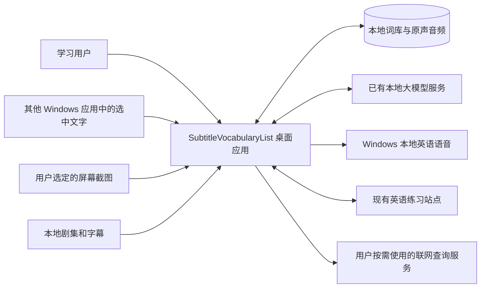

# SubtitleVocabularyList 架构设计文档

| 项目 | 内容 |
| --- | --- |
| 文档编号 | DOC-ARC-001 |
| 文档版本 | 0.46 |
| 对应产品版本 | 0.1 基线；0.4.0 听读、0.5.0 Pot 替代、0.6.0 写作翻译及 0.7.0 底库增量 |
| 更新日期 | 2026-10-17 |
| 状态 | 初版待评审；技术栈与已确认约束已确定，其余设计待验证 |
| 需求依据 | [产品需求文档](../requirements/PRD.md) |
| 管理规范 | [文档管理规范](../README.md) |
| 详细设计 | [数据模型](data-model.md)、[应用流程](application-flows.md)、[接口契约](interfaces.md)、[高频水平测试提案](vocabulary-assessment.md) |
| 实施与验证 | [开发计划](../planning/development-plan.md)、[测试计划](../testing/test-plan.md) |

本设计定义 Windows 桌面应用的技术栈、系统边界、模块职责、数据关系及集成约束。需求范围和验收标准以 PRD 为准。系统以本地词库为日常使用基础，采集、剧集导入和在线同步通过统一收录与合并逻辑连接学习核心。

## 1 设计依据与关注点

| 相关方 | 主要关注点 | 需求依据 |
| --- | --- | --- |
| 学习用户 | 离线可用、按词预习、原声复习、重复内容合并、测验与易忘词专项 | FR-01 至 FR-12、NFR-01 至 NFR-05 |
| 项目维护者 | 职责清晰、错误可定位、第三方复用可维护、需求与验证可追溯 | NFR-02、NFR-03、NFR-04 |
| 现有站点维护者 | 桌面认证、词条数据兼容、同步重试与冲突、多例句扩展 | FR-06、FR-12 |

本文提供系统上下文、模块、概念数据、主要运行流程和部署依赖视图。当前能力及证据以第 4.1 节为入口；具体数据表和命令参数在对应详细设计中维护，历史验证保留其版本与范围。

## 2 已确认架构决策

| 决策编号 | 决策 | 状态 | 依据与影响 |
| --- | --- | --- | --- |
| DEC-01 | 采用 Tauri 2、TypeScript/React、Rust、SQLite | 已确认 | 用户明确确认技术栈；界面、桌面宿主、原生核心与本地持久化各自分工 |
| DEC-02 | 独立开发应用，选择性吸收 Pot 核心实现 | 已确认 | 用户选择独立架构与有限复用；运行不依赖已安装或正在运行的 Pot |
| DEC-03 | 核心本地运行，按需连接外部服务 | 已确认 | 满足 NFR-01、NFR-04、NFR-05；本地使用不要求在线账号 |
| DEC-04 | 接入用户现有本地大模型服务，并提供 Windows 本地英语语音兜底 | 已确认 | 满足 FR-07、FR-08；模型不可用时保留基础学习流程 |
| DEC-05 | 同步对象是现有英语练习站点的在线单词本 | 已确认 | 满足 FR-12；需要兼容现有内容并扩展集成能力 |
| DEC-06 | 项目采用 GPL-3.0-only | 已确认 | 用户明确选择兼容 Pot 复用的许可；实际第三方引入分别记录来源与许可 |
| DEC-07 | 双向同步包含词条、释义、例句、原声和学习记录 | 已确认 | 用户明确选择完整同步；站点需扩展相应数据、媒体及认证接口 |

### 2.1 技术栈职责

| 技术 | 负责内容 | 实现边界 |
| --- | --- | --- |
| Tauri 2 | 桌面窗口、托盘、应用生命周期、界面与原生核心通信 | 作为宿主与连接层，业务规则集中在应用核心 |
| TypeScript/React | 候选词确认、收录窗口、词条浏览、测验与任务状态界面 | 通过明确命令访问核心，不分别维护多套合并和复习规则 |
| Rust | Windows 采集、导入任务编排、词条合并、复习规则、存储与同步适配 | 原生操作与耗时任务向界面返回结果、进度或错误 |
| SQLite | 词条、例句、来源、收录记录、学习记录、复习状态和同步元数据 | 由核心统一管理连接、事务和数据迁移 |

原声音频保存为应用管理的独立文件，数据库保存关联信息。除 Tauri 的主版本外，依赖的具体版本应在首次实现时核对、锁定并记录，本文不预设未验证的库版本。

## 3 系统上下文

剧集、截图和本地识别流程在本机完成。联网查询与站点同步由明确的用户操作或启用的设置触发，其发送字段由集成契约定义。本地大模型属于独立的本机服务，不由应用重新部署一套模型运行环境。

## 4 模块视图与依赖

0.1 采用一个桌面应用中的模块划分。采集、语言服务、媒体处理和站点接口位于边界适配层；统一收录、复习与业务状态属于应用核心。

| 模块编号 | 模块 | 职责 | 主要依赖 |
| --- | --- | --- | --- |
| ARC-01 | 桌面界面与宿主 | 主窗口、采集确认窗口、按词预习、浏览、测验和状态显示 | Tauri 通信、ARC-04、ARC-05 |
| ARC-02 | Windows 采集 | 全局触发、选中文字、截图区域、OCR 结果，处理焦点与取消 | Windows 适配、OCR 适配、ARC-04 |
| ARC-03 | 剧集导入 | 文件与文件夹任务、字幕与音轨选择、转写、时间位置、候选词整理、音频截取 | 媒体与语音识别工具、ARC-04、ARC-07 |
| ARC-04 | 词条收录与合并 | 候选确认、规范化匹配、类型与语境判断、例句与音频追加、主动收录记录 | ARC-06、ARC-07 |
| ARC-05 | 测验与复习 | 出题、作答与判分记录、复习状态、计划、易忘词专项 | ARC-04、ARC-06、ARC-07 |
| ARC-06 | 语言与播放适配 | 本地解释、可选联网查询、原声播放、Windows 语音、辅助判题 | 本地模型、音频文件、系统语音、查询服务 |
| ARC-07 | 本地数据与任务存储 | 数据事务、媒体引用、来源、任务阶段、学习历史和同步队列 | SQLite、应用数据目录 |
| ARC-08 | 站点同步 | 认证适配、增量交换、去重、冲突与失败重试 | 站点接口、ARC-04、ARC-07 |
| ARC-09 | 查询会话与服务编排 | 独立小窗会话、输入版本、交互优先、服务注册和声明式插件 | ARC-01、ARC-02、ARC-04、ARC-06、ARC-07 |
| ARC-10 | 高频水平测试 | 完整排名、题库核对、独立会话、分频段报告及复测；不更新原复习排程 | ARC-01、ARC-04、ARC-06、ARC-07、ARC-08 |

FR-14 至 FR-18 的后续方案见 [Pot 替代功能设计](pot-replacement.md)。新查询会话只在用户明确收录时进入 ARC-04；原有 Tauri／React／Rust／SQLite 及离线边界保持。ARC-09 已由 queries.rs、providers.rs、desktop_query.rs 和 QueryView 接通，会话、服务配置及 query_results 分工保持；实际覆盖见 [Pot 替代验证](../testing/pot-replacement-results.md)。

FR-19 的 [选区翻译并替换](selection-replacement.md) 已在 0.6.0 接通：ARC-02 由 desktop_replacement.rs／replacement_target.rs 增加可编辑目标、事件及范围核对、一次粘贴和读回；ARC-09 复用私有 replacement 会话、translate 服务及缓存，ARC-06 保持本机执行。替换不经过 ARC-04 自动收录，不修改技术栈；剪贴板支持范围和实际控件证据见 [增量验证](../testing/selection-replacement-results.md)，不声明全应用兼容。

所有采集入口通过 ARC-04 执行相同的业务规则。ARC-08 接收在线内容后也调用统一合并逻辑；同步重放与用户主动再次收录应使用可区分的操作语义。

界面与核心的命令应返回结构化成功结果或明确错误。耗时任务使用任务标识报告进度和最终状态，避免以日志或窗口事件代替操作是否成功的判断。

### 4.1 当前实施位置

下表反映当前 0.8.24 的实现。后续版本段落解释设计沿革，历史状态不能覆盖当前能力。

| 能力 | 当前实现 | 验证与边界 |
| --- | --- | --- |
| 离线词库、统一收录及复习 | 独立个人库，可选基础词库故障隔离，例句／原声／学习事件完整保存 | [基础词库](../testing/base-dictionary-results.md)、[复习记录](../testing/review-results.md)；硬件与采集环境按原实测范围 |
| 听读与后台状态 | 正文／进度分离，任务快照加事件、按需补查 | [性能记录 §11](../testing/performance-results.md#11-0811-任务事件与按需补查)；播放位置计时保持 |
| 命令与固定 DTO | desktop/commands 按 8 个业务域注册，Rust 生成前端类型及过期检查 | [§4.1.1](#411-桌面命令适配层与类型表0812)；动态载荷仍有收紧空间 |
| 完整同步与历史增长 | 词条和测试会话差量上传／下载，站点检查点加历史差量，原声按摘要复用 | [同步设计](synchronization.md)、[真实验收](../testing/synchronization-results.md)；最近真实正常证据为 0.8.20，容量及对象回收见优化清单 |
| 水平测试及报告 | assessment、assessment_reports、assessment_sync 接通，业务内容决定报告版本，完整题目和旧报告可复用 | [测试记录](../testing/vocabulary-assessment-results.md)、[性能记录](../testing/performance-results.md)；已实现，题库质量／真人验收保留各自范围 |
| 本地处理与存储 | 单连接事务，耗时 IPC 后台执行、逐词冻结、锁外编码、未变行跳过更新、新报告与派生状态一次提交 | [性能记录](../testing/performance-results.md)；正常样本不证明固定延迟或长期性能 |

原始七项及后续建议的完成依据和剩余工作统一见[架构优化收尾清单](../planning/architecture-optimization-plan.md)。0.8.24 将报告业务指纹和历史内容摘要的派生缓存放在 assessment_reports/cache.rs，独立报告读取和同步复用同一业务逻辑；元数据随 PreparedReport 原子保存，不增加独立事务、迁移、网络协议或完整正文副本。0.8.23 最近包的题目／报告投影复用继续保留，详见[报告设计](vocabulary-assessment.md)及[性能记录 §25](../testing/performance-results.md#25-0824-报告业务输入与历史摘要复用)。

0.8.19 的 local_profile 以可选操作作用域记录固定阶段耗时，Store 连接守卫记录当前线程在该作用域内的单连接互斥等待及持有时间。assessment_sync 使用一份按账号／会话／epoch 核对的最近完整快照，读取与短提交之间释放连接，摘要及发送／回执 JSON 编码在锁外执行；接收复用同一本地资料摘要。既有单连接事务及完整校验保持，详细时序见[同步设计 4.6](synchronization.md#46-本地完整会话复用与短事务0819)，实际采样不扩大为并发或固定延迟保证。

0.8.20 将会话准备中的报告位置、同步设备标识等派生设置延后到摘要发布事务，值相同时不重写；内存命中不再开启读取事务。回执在同一事务内确认冻结摘要仍对应当前 epoch 后，才将缓存推进到基准更新后的 epoch。接收依据该元数据跳过已确认未变资料的完整比较，必要三方合并复用同一份解码基准；原始输入与合并结果仍经完整校验，原声、历史及接收后的实际本地完整投影继续核对。写提交范围可单独诊断，见[同步设计 4.7](synchronization.md#47-减少派生写提交与接收重复处理0820)；无新 schema 或网络协议。

当前 `desktop.rs` 负责 Tauri 启动、窗口、快捷键、托盘和退出生命周期，`desktop/commands` 按业务域适配 IPC 与应用状态；`application.rs` 编排导入、收录和本地解释。`tasks.rs` 将业务后台快照和失败诊断写入 SQLite，日常播放、朗读、听力音频准备及解释的正常执行使用有限内存回执，取消与退出覆盖全部执行。`explanations.rs` 持久保存中文解释资料，回执淘汰不删除资料。`media.rs` 处理本地字幕、PGS OCR、转写与截取；`corpus.rs` 管理来源、候选和原声文件；`vocabulary.rs` 统一合并与持久化。React 界面通过对应命令展示预习、词库、确认和任务，不自行写数据库。

`preparation.rs` 在原生进程统一安排导入后及已有语料的后台中文准备，以 explanation_batch 持久记录整体与分集进度。可复用工作线程按配置处理项目，由一个协调线程汇总结果及进度；`model_gate.rs` 用请求许可统一限制后台和显式单项解释，默认 1，并使相同目标/完整语境的在途请求互斥，提交后复用缓存。保存配置更新运行期上限，协调线程按需增加工作线程；降低上限时等待在途工作完成，不取消已开始的请求。仅限制客户端请求，不修改外部模型服务启动参数。前端 sourceGroups/SourcePicker 按标题派生剧名、季、集选择；localExplanations 只读取已准备数据并刷新状态，不承担模型队列生命周期。退出停止原生调度，已保存资料独立于页面和任务回执保留。

0.6.2 将后台单位改为跨集去重的通用词义与独立整句译文。preparation.rs 按规范化词键／完整原句各取一项，跳过对应数据库缓存，不再全量展开词×对白。batch_explanations.rs 分别请求通用释义批次和句子翻译批次，共用原模型许可、重试和逐项保存。modelBatchSize 仍默认 8，作为每次词条或句子数上限，在途批次不受设置变化打断。任务用 wordsTotal/wordsCurrent 和 sentencesTotal/sentencesCurrent 分别统计；sources 仅标明来源与处理归属，不代表每集都重新解释相同词。

explanations.rs 的 prepared_explanation 优先读取已有语境释义，其次空 context 的通用词义，配合 sentence_translations 返回独立译文；已有译文可先于词义显示。CMD-29 为只读拼装，不调用模型。008 从旧解释库迁入有效译文，不删旧语境释义；明确请求特殊语境时仍沿用原 explain_start。正常验证与当前资料队列口径见[去重记录](../testing/preparation-dedup-results.md)。

上述部分已有真实桌面证据，详见[桌面增量验证](../testing/desktop-import-results.md)。Windows 增量使用 `windows_native.rs` 隔离 UI Automation、SAPI 和 GDI 原生接口，`desktop_capture.rs` 管理全局触发、前台顺序和托盘生命周期，`desktop_ocr.rs` 管理截图会话与裁剪；采集结果通过统一收录核心保存。系统语音生成本地 WAV，播放沿用现有播放器。WPF 实际取词和语音证据见[Windows 记录](../testing/windows-capture-results.md)，截图证据见[OCR 记录](../testing/ocr-results.md)。`reviews.rs` 已接入私有题目快照、确定性判分和人工确认、同事务作答与修正、收录事件重放及专项列表，策略唯一来源为[策略设计](review-policy.md)。查询与完整同步的当前实现见下文及各自增量记录，发行与兼容验收保留实际范围。

`sync_data.rs` 已按共享字段契约导出词条和 12 类关联资料，排除设置、凭据与素材路径；桌面完整推拉、映射、冻结队列和冲突处理已接通，当前实现及实际验证范围以[同步设计](synchronization.md)和[同步验证](../testing/synchronization-results.md)为准。004 迁移及浏览的 contexts 读取修正同句多语境，复用原句、音频和已有历史。当前停止点及恢复方法见[笔记本交接](../development/laptop-handoff.md)。

0.8.10 将数据库相关 IPC 命令统一转交既有 background／spawn_blocking 执行，覆盖水平测试、任务读取、收录、已掌握状态、媒体定位、设置及同步等；主线程不执行这些命令的 SQLite 锁等待。同步建立映射和冻结完整词条包时逐词提交事务，在词条之间释放业务连接；发送队列一次读取一份待发送包。单词包内部的基准、epoch 和 changeId 仍在同一事务冻结，重试继续使用原包。业务库仍为单连接互斥，不宣称已实现并行读写或通过新的性能指标。

0.8.14 在现有完整同步协议内，使用已确认修订跳过回声下载、释放终态队列中的重复快照，并按会话变更计数缓存水平测试摘要。HTTP 逐会话冻结发送，词条历史与报告槽位通过索引查找；原声确认只在同次同步内复用。业务库升为 schema 10，不删除例句、原声、作答、修正和旧报告。详细边界见[同步设计 4.2](synchronization.md#42-同步增长控制0814)与[数据模型第 12 节](data-model.md#12-同步增长元数据schema-10)，不宣称已部署差量协议或量测性能达标。

0.8.15 增加协商式 json-delta-1 上传编码。sync_delta 根据账号、实体和确认版本读取完整基准，比较字段及数组中未变化的行；sync_transport 仅在差量更小时发送，并支持基准缺失后的完整重试。站点 sync-delta 还原完整包后进入原校验和提交函数，现有冻结队列、回执、三方合并及 schema 10 保持。新增报告作为完整新成果发送，旧报告不重复上传；首次同步与下载仍是完整快照。协议、部署及验证边界见[同步设计 4.3](synchronization.md#43-实际变更差量上传0815)。

0.8.16 复用 json-delta-1 进行有基准的下载。站点按请求中的确认版本生成差量，sync_transport 下载内联／分片差量，sync_delta 在已确认完整基准上还原，随后交回原完整包校验、原声保存与合并流程；本地未同步修改不作为差量基准。Remote.change 接收带实体和版本的变更元数据，HTTP 适配器据此读取账号下的确认基准，数据库锁不跨越网络请求。词条和水平测试游标仍在完整持久化后推进；首次／旧端／缺少基准保持完整下载。完整基准计算、业务存储及 schema 10 不变，见[同步设计 4.4](synchronization.md#44-已有确认基准的差量下载0816)。

0.8.17 优化站点内部存储：sync-codec 保存纯差量比较／应用；sync-packets 管理完整检查点、最多 15 个差量的历史还原、摘要和原分片对象；sync-delta 复用已确认的相邻版本变化并编排兼容回退。业务写入继续完整校验、按完整内容核对回执和条件提交，但复用一次还原的上传基准，不再次读取同一完整历史。D1 变更表新增账号／实体／修订索引；旧快照不批量重写，桌面 schema 和线上完整包字段保持。详见[同步设计 4.5](synchronization.md#45-服务端检查点与已校验差量复用0817)与[数据模型第 13 节](data-model.md#13-站点历史存储0817)。

基础词库作为可选适配器分别初始化，资源异常转为 dictionaryWarnings，不传播为 Store::open 的失败；运行期 ECDICT 读取错误停用该资源，健康词典与个人资料继续使用，详见[基础词库故障隔离](base-dictionary.md#33-可选资源故障隔离0810)。

0.8.11 的任务状态先订阅 task_updated 再查询当前快照，主窗口按事件更新列表，任务终态合并刷新应用信息；事件携带由原生规则计算的 visibleInList，临时成功／取消仍不进入后台列表。waitTask 复用事件等待结果，完成后释放监听。主窗口、单项等待和查询小窗只在可见且仍有未结束操作、连续 10 秒无事件时补查；恢复窗口时读取快照，空闲及隐藏窗口不常驻轮询。本地解释通过主窗口分发的准备任务通知合并读取，替代每项 1.5 秒轮询；音频播放中的位置计时保持原用途。

#### 4.1.1 桌面命令适配层与类型表（0.8.12）

106 个现有命令从宿主文件移入 `src-tauri/src/desktop/commands`，由 `mod.rs` 唯一注册并共享 AppState 和 background。子模块保持薄适配职责，调用既有应用与存储方法，不另建业务层或数据入口：

| 模块 | 命令职责 |
| --- | --- |
| system | 应用信息、设置、任务快照、托盘待办与退出 |
| capture | 选区、截图会话与翻译替换 |
| corpus | 来源、导入、候选与已掌握标记 |
| vocabulary | 词库浏览与编辑、统一收录、原声定位与预览 |
| learning | 主动回忆、听读正文／进度、系统语音 |
| query | 查询会话、服务配置、声明式插件与中文准备 |
| synchronization | 站点连接、词条同步与冲突处理 |
| assessment | 独立水平测试的题库、会话、报告、收录与同步入口 |

0.8.12 以前端 CommandMap 集中关联命令名、camelCase 参数和成功结果；`src/api.ts` 的 call 根据命令推导类型，界面不再自行指定返回类型。水平测试操作回执包装也限定命令与输入，仍复用原 operationId 重试规则；听读二进制音频经过同一入口传递 Uint8Array。

0.8.13 将 CommandMap 与可达的嵌套 DTO 改为由 Rust 生成到 `src/generated/ipc.ts`，`src/commands.ts` 只保留调用辅助类型，types／queryTypes／assessmentTypes／practice 复用生成定义。项目内 `svl-ipc-macros` 复用同一份命令函数签名及 catalog 注册，为 Tauri 生成原调用入口，为导出工具收集参数和成功结果；不再用正则解析 Rust 签名。DTO 使用可选 ipc-types 特性的 ts-rs 12.0.1（MIT）派生，跟随 Serde 的字段命名、枚举、嵌套容器和 flatten；正常桌面运行不启用此生成依赖。库来源与支持属性见 [ts-rs 官方说明](https://docs.rs/ts-rs/12.0.1/ts_rs/)。

固定形状的水平测试 JSON 结果、截图会话及同步冲突在 IPC 边界使用明确的 ipc_dto。旧核心 JSON 投影经过反序列化与字段保持核对再返回，不静默丢弃新增字段；数据库读取和较大投影仍在 background 工作线程中。同步 entry 的额外字段完整保留，协议表行继续为动态 JSON，不修改原同步协议或库 schema。

`pnpm commands:generate` 显式更新生成文件；已纳入 build 的 `pnpm commands:check` 重新运行只导出类型的 Rust 工具并只读比对，因此能发现嵌套字段、空值、容器、返回类型和命令参数变化，过期时要求重新生成。该开发工具需要本机 Rust／Windows 桌面编译依赖，但不启动应用、不读取个人资料、不打包。原业务、后台执行与事件规则保持，需求基线不新增功能。0.8.12 的历史检查边界见[第 12 节](../testing/performance-results.md#12-0812-命令模块与类型契约)，本轮结果见[第 13 节](../testing/performance-results.md#13-0813-rust-生成的嵌套-dto-与返回契约)。

### 4.2 网站学习功能的本地整合（FR-13）

对照现有 `english-practice/dist/app.js` 与 README，本地已有词库、例句编辑、原声、学习历史、测验及认证同步；此次新增的部分是阅读／课程导入、逐句输入与连续听读。网站的账号 API 不作为本地学习前提，原有 React／Tauri／Rust／SQLite 技术栈保持。

`PracticeView.tsx` 负责章节、句子、输入反馈、速度、原声／本地语音切换、连续播放及选词；`practice.ts` 在本机解析 TXT、EPUB 阅读顺序及课程元数据。JSZip 3.10.1 通过 npm 锁文件随前端提供，采用其 MIT 许可，不引用另一个项目的运行资源。书籍 HTML 只提取文字，脚本、样式、导航与 SVG 不进入页面。

Rust `practice.rs` 使用 SQLite 现有 settings 表分别保存当前完整阅读 practice_document 与小型进度 practice_progress；导入及旧记录拆分使用事务，日常保存只更新进度，practice_get 保持原返回结构。旧 practice 合并记录首次读取时转换，不新增 schema 迁移。课程原声保存在 `media/practice`；收录按稳定章节／句子位置关联 `reading` 来源、例句，并使用既有 `collection_prepare/collection_from_example/collection_commit` 和 `ensure_clip`。日常朗读复用 SAPI 本地 WAV，练习声音覆盖只作用于此次请求，不修改全局设置。

练习状态和完整阅读不属于同步资料包。只把用户确认收录的词条、例句、独立原声及既有学习记录送入原同步流程；抄写不更新复习成绩。实现与最低必要验证见[听读整合记录](../testing/practice-integration-results.md)，网站和安装包验收分别保持原有边界。

### 4.3 高频水平测试增量（FR-20 至 FR-24，已接入）

新增 ARC-10，复用已有技术栈、TaskManager/ModelGate、媒体与统一收录事务，独立维护水平测试事实。完整词频索引保留无中文释义目标，题库发布及会话快照不可变，前端只读取可见题面；以 schema 下一迁移增加个人 assessment 表，不把测试写入 review_attempts 或批量已掌握标记。完整测试历史采用独立会话包及能力协商，不改变原词条同步协议。

详细模块、数据、CMD-46 至 CMD-60、初始策略和兼容方案见[高频水平测试设计](vocabulary-assessment.md)，实施见 [M-15 至 M-19](../planning/vocabulary-assessment-plan.md)。M-15 已落地 assessment_bank.rs、业务 schema 9 与 Google 参考 schema 2，以及目录／配置／准备／审核发布命令，当前为 0.8.0 开发中。M-16 已接入 assessment.rs／assessment_sampling.rs 的会话、抽样及判分核心；M-17 桌面与 M-18 报告、可信收录已接入，M-19 的 assessment_sync.rs 与站点版本 27 已接入完整历史和独立同步；TC-58 实际正常往返通过，真人体验与题库质量验收另行记录。

## 5 概念数据视图

FR-08 的[离线基础词库](base-dictionary.md)将 Google 与 ECDICT 分别保存为 `Data/dictionaries/base.sqlite3`、`ecdict.sqlite3`；Google 词头和明确词形映射在启动时只读加载，ECDICT 使用只读 SQLite 索引按需查询。Google 直接／词形均优先于 ECDICT 直接／词形，双库均缺失才请求模型。后台准备先过滤命中词语，解释及 Qwen 词语查询在申请模型许可前复用底库。业务 schema 仍为 8；底库不参与生词本同步，不把通用释义当作特定语境解释。

查词层独立统一撇号字形，明确变体和基础缩写解释由 `src-tauri/resources/dictionary-supplements.json` 维护，Rust 运行时与 Python 覆盖统计读取同一份规则。基础缩写补充作为 Google 之后、ECDICT 之前的已核对缺项／错项校订层，来源与词典原文区分。普通查询均未命中时才尝试列明的变体目标，不改动业务规范化、原文、缓存键或同步标识；具体顺序和歧义边界见详细设计。

以下实体用于表达需求关系，不是最终数据库表或字段契约。

| 概念实体 | 内容与关系 | 需求依据 |
| --- | --- | --- |
| 词条 | 稳定标识、内容类型、原始文本与辅助匹配信息；关联多个例句 | FR-05、FR-06 |
| 例句与语境释义 | 原句、本次含义、用户修订；关联词条、来源和可用音频 | FR-05、FR-06、FR-07 |
| 来源与出现位置 | 素材标识、剧集或应用来源、时间位置；保留真实出现关系 | FR-01、FR-02、FR-06 |
| 音频资料 | 文件标识、类型、来源与片段位置；供例句和题目引用 | FR-07、FR-10 |
| 主动收录记录 | 用户明确收录行为与原始操作标识，区分重试和同步重放 | FR-06、FR-11、FR-12 |
| 测验记录 | 题型、能力维度、回答、提示、判分与修正关系 | FR-10、FR-11 |
| 复习状态 | 按词条或学习单元及能力维度维护的当前状态、下次安排 | FR-10、FR-11 |
| 导入任务 | 输入标识、处理阶段、结果与失败信息 | FR-01、NFR-03 |
| 同步元数据 | 操作标识、版本或游标、待同步状态与冲突信息 | FR-12 |

### 5.1 存储与一致性

- SQLite 保存结构化记录，媒体目录保存已收录原声；数据库中的媒体定位应允许整个应用数据目录迁移。
- 0.6.1 的 app_paths 在创建 WebView 前解析资料根目录：发行程序使用可执行文件目录下 Data，本机 debug 与测试脚本默认 D:\SubtitleVocabularyList\Data；SVL_DATA_DIR 仅作为显式覆盖。主窗与查询窗共享绝对 cache/webview，本进程临时目录为 cache/temp；开发／发行标识统一以沿用单实例约束。迁移及实际结果见[目录说明](../development/data-directory.md)，对应 NFR-02、NFR-06。
- 词条与相关资料的确认保存需要有完整结果。音频尚未保存成功时，不应把未存在的音频引用标为可播放。
- 素材与片段具有可识别的来源信息，例句和音频去重不能删除新的主动收录记录。
- 用户纠错、判分修正和复习更新保留可追溯关系。具体事务与中断恢复流程进入详细设计。
- 实际匹配键、数据库约束、删除行为和数据迁移策略在数据设计阶段确定，不能只以小写拼写替代类型与语境判断。

## 6 主要运行流程

### 6.1 剧集导入

读取素材信息、选择可用音轨和文本字幕、必要时本地转写、整理带来源的候选词、等待用户确认，再通过收录核心保存例句及原声。

文件夹任务按素材独立记录阶段与结果。用户取消或某项失败时，保留已完成和已收录内容。重复导入应识别已处理来源，用户主动再次收录仍作为不同的业务操作记录。

原字幕文字与时间位置应保留。字幕可能包含时间重叠、缺失或与音轨不一致；校正应有明确结果，不将识别或对齐失败标记为成功。

### 6.2 划词与截图

获取本次操作标识和输入，完成取词或截图裁剪与 OCR，返回本次识别结果，进入确认窗口，再执行收录。焦点与剪贴板回退属于原生适配细节，需要在支持的应用中验证。

每次操作的临时输入与结果应对应。取消、空选区、裁剪失败或 OCR 失败需要明确终止该次处理，防止固定缓存文件或旧剪贴板内容混入本次结果。

### 6.3 测验与易忘词

根据已保存复习状态选择内容，按对应维度出题，记录回答与提示，完成判分或人工修正，再更新该维度状态。专项根据失败和主动重复收录记录选择内容，并展示选择原因。

复习间隔由明确算法与规则计算。大模型提供语言解释或辅助判分；大模型不可用时仍应存在可用的基础测验与人工确认方式。

### 6.4 同步

记录本地待同步修改，完成真实站点认证后交换已定义的数据，按操作标识与来源合并，再确认处理状态。网络失败后可重试，同一操作的重试应得到幂等结果。

新增例句与学习事件按稳定标识合并，文字并发修改保留两端版本供选择，网站移除保留完整资料并要求本地归档或恢复。共同版本、账号隔离、冻结回执重试与原声传输见[同步设计](synchronization.md)；未发生业务修改的学习投影不形成回推回环。

## 7 外部接口与技术约束

### 7.1 本地大模型

- 用户提供的服务地址为 `http://127.0.0.1:8096/`。
- 接入采用其现有 OpenAI 兼容接口，模型名称按服务能力或配置确定，不假设永远固定为某个模型标识。
- 本地请求的超时、取消、并发量、结果格式和客户端兼容参数应进入适配设计并验证。
- 翻译与解释结果可缓存和修订；服务异常返回可见状态，保留候选原文。

联网查询由 `lookup.rs` 适配 Wiktionary 的英语词典与 MyMemory 的中文机器翻译，分别由明确按钮触发，不附带语境或词库。界面说明发送字段和来源，结果只作为待确认建议。默认允许联网；手动离线拒绝外网请求。Application 统一跟踪在线查询、站点连接和同步任务的连接失败，运行期降级不写入手动设置，也不阻断后续重试；本地模型 HTTP 禁用代理与重定向，保持回环服务边界，不参与外网状态判断。选择、语境、联网恢复和自动解释建议之间的状态规则见[流程设计](application-flows.md)。

### 7.2 Windows 采集与语音

当前取词使用 Windows UI Automation TextPattern，先获取选区，再显示收录窗口，不读取或改写剪贴板。只声明实际验证的支持范围；不支持的提供方、前台变化和权限问题保持失败。截图仍需验证多显示器坐标、屏幕缩放和窗口焦点，未据划词结果宣称截图兼容。[Microsoft TextPattern 文档](https://learn.microsoft.com/en-us/windows/win32/api/uiautomationclient/nn-uiautomationclient-iuiautomationtextpattern)

系统 OCR 的官方桌面支持要求应用具有包身份，通常通过 MSIX 安装。因此 OCR 引擎与打包方式需要一起评估，不能把普通安装程序下的调用行为直接当作已支持。[Windows OCR 文档](https://learn.microsoft.com/en-us/uwp/api/windows.media.ocr)

无原声时使用 Windows 已安装的英语语音。本轮 SAPI 实际生成、播放器和取消结果已记录；选择英语 token 并以明确 WAV 格式输出，保留 WaitUntilDone 的超时语义，生成结果不直接计为已播放。[Microsoft 流格式文档](https://learn.microsoft.com/en-us/previous-versions/office/developer/speech-technologies/jj149357(v=msdn.10))

### 7.3 媒体处理与转写

当前原型使用 FFmpeg 处理音轨与字幕，Tesseract 识别英语图像，`libbitsub-core` 解码 PGS，`whisper.cpp` 的英语模型执行无可用字幕时的离线转写。版本与验证边界写入实际记录；原型成功不自动代表所有格式均已验收。

已有英语练习项目的素材处理流程支持文件或文件夹输入，并生成包含 `lesson.json`、`audio.m4a`、文本和字幕的学习包。格式与处理经验可以作为导入设计参考，不能因此使桌面程序必须依赖另一个项目的安装环境。

### 7.4 现有英语练习站点

集成前提来自 2026-10-06 核对的本地站点源码，部署环境的实际能力需要另外验证：

| 当前源码行为 | 对桌面集成的影响 |
| --- | --- |
| `db/schema.ts` 的词库记录保存用户、词键、词、单条释义、单条语境和创建时间 | 需要扩展多例句与来源关系，不能用单条语境覆盖新旧收录内容 |
| `server/index.js` 提供 `/api/vocabulary` 的读取、写入和删除 | 可作为兼容入口参考，但没有完整增量同步契约 |
| 用户身份取自宿主提供的认证请求头，写入与删除校验同源 Origin | 桌面需要可验证的认证方案；自行填写身份请求头不能代替认证 |
| 当前词库模型没有原声音频和复习状态 | 已确认完整同步，需要扩展媒体、学习记录存储和接口 |

桌面账号授权、完整推拉和旧网页词库桥接已接通。当前增量完成真实双向例句、原声与学习历史、重复交换和并发释义处理；故障与容量余项见[同步验证](../testing/synchronization-results.md)，不据主流程通过宣称完整 0.1 已验收。

2026-10-07 已通过 Sites 工具核实并沿用现有 [English Practice](https://english-copy-practice.hxwjb.chatgpt.site)。上述表保留旧版本集成基线，当前版本事实唯一维护在[同步设计](synchronization.md)。`site_connection.rs` 编排 HTTPS 连接，`credentials.rs` 用 Windows 当前用户 DPAPI 保存凭据；`sync_http.rs` 对接正式接口，`synchronization.rs` 管理事务、资料基准与别名，`sync_merge.rs` 校验并合并完整资料。界面不取得原始令牌；平台站点访问服务凭据不能代替个人词库认证。用户已在真实浏览器批准笔记本连接，主流程交换证据独立记录。

`sync_transport.rs` 隔离有限 JSON 读取与大包分片，使用相同连接校验和取消规则。站点大快照在 R2 保留全部字段，D1 保留检索摘要、版本与引用，避免把长历史删减成小包；业务 schema 1 与本地 schema 5 不变。Rust 内部库使用 `subtitle_vocabulary_list_core`，与主程序的 Windows PDB 名称区分，公开产品名和安装器名继续为 SubtitleVocabularyList。

## 8 部署与离线资源

界面资源随应用提供，本地数据库与个人媒体存入应用数据目录。工具、识别模型、Windows 英语语音和 WebView2 运行时应在离线使用前可用，不能在核心流程中隐式依赖外网下载。

Tauri 的 Windows 打包支持包含 WebView2 离线安装程序。最终采用的安装方式要与 OCR 引擎、运行时和离线资源一起验证。[Tauri Windows 打包文档](https://v2.tauri.app/distribute/windows-installer/)

当前发行实现采用当前用户 NSIS，随附 WebView2 离线安装程序，以及从固定源码构建的 FFmpeg/ffprobe、Tesseract 与英语数据、Whisper CLI 和 base.en。release 宿主以 Tauri 资源目录解析 `tools`，debug 宿主使用开发默认路径；用户设置保存模型、声音、快捷键和联网偏好，工具位置属于当前运行环境的只读信息，不再持久化旧机器路径。调用 Tesseract 时仅给该子进程设置随包 tessdata，不改系统环境。源码匹配打包、许可证与依赖源码由 scripts 下的发行入口管理，实际证据见[安装验证](../testing/offline-release-results.md)。

版本升级应保留已有词库和原声；数据库变更进入迁移设计。安装、升级及数据目录位置在可运行版本形成后写入交付文档。

0.7.3 的发行入口在构建前从固定版本词表单独生成 Google／ECDICT，使用 Tauri 资源的显式文件映射写入所选安装目录的 `Data/dictionaries`。仅两份底库、清单及三份来源说明是受安装器管理的资源，`Data/vocabulary.sqlite3`、学习记录、缓存和媒体不是安装资源。NSIS 沿用安装前退出运行程序及覆盖资源的流程，不新增启动时复制或下载步骤。standalone 输出复用同一映射，只复制列明文件，不整体替换 Data；本机 debug 默认共用资料路径不变。资源流程验证与真正 NSIS 构建／安装验收分开，见[验证记录](../testing/dictionary-packaging-results.md)。

## 9 第三方复用与许可

Pot 仅作为可审查的实现来源。优先评估取词、截图与原生适配相关实现，明确依赖后接入本项目模块；应用状态、业务规则、持久化和复习能力按本项目设计实现。

Pot 被审查版本的包元数据标注 `GPL-3.0-only`。[对应源码](https://github.com/pot-app/pot-desktop/blob/594d32ede96acd106b0256deaa8bb440ffcdff40/src-tauri/Cargo.toml)

引入第三方代码前应记录项目来源、版本或提交、文件范围、许可、改动和分发义务。独立底层库按各自许可核对；选择性复制代码不能被视为自动免除原许可约束。项目已采用 GPL-3.0-only，当前未复制 Pot 源码，使用独立底层依赖及本项目实现。

## 10 待验证与待决策项

| 编号 | 事项 | 所需结果 | 关联需求 |
| --- | --- | --- | --- |
| TECH-01 | Windows 取词方式与截图实现 | 支持应用、焦点与剪贴板行为、取消与失败、屏幕配置验证记录 | FR-03、FR-04 |
| TECH-02 | OCR 引擎与安装方式 | 本地识别效果、部署条件、资源大小和离线验证 | FR-04、NFR-01 |
| TECH-03 | 字幕处理、语音识别与音频截取引擎 | 真实素材结果、时间定位、处理耗时、资源占用与取消行为 | FR-01、FR-07、NFR-03 |
| TECH-04 | 数据结构与核心命令 | 匹配、合并、媒体保存、学习记录和中断恢复的详细契约 | FR-05、FR-06、NFR-02 |
| TECH-05 | 复习算法、判分和专项规则 | 可执行规则、参数、人工修正与离线基础路径；FSRS 可作为候选评估 | FR-10、FR-11 |
| TECH-06 | 站点认证与同步协议 | 真实认证、数据边界、版本、幂等、冲突与失败恢复设计 | FR-12、NFR-04 |
| TECH-07 | 第三方引入与分发许可核对 | 项目许可已确认为 GPL-3.0-only；继续核对实际依赖与工具的来源、许可和分发要求 | DEC-02、DEC-06 |
| TECH-08 | 完整离线交付与升级 | 安装资源、运行时、数据目录和迁移验证 | NFR-01、NFR-02 |

原型验证优先覆盖取词、截图 OCR 和真实剧集处理。这里的验证计划不是实施完成记录；实现后应把实际结果记录到验证文档并更新本表。

TECH-04 的逻辑模型与命令、TECH-05 的测验状态、TECH-06 的同步语义已形成上述详细设计提案，仍待评审、接口对齐与验证。方案写入文档不代表待决策项已经关闭。

## 11 需求追溯

| 需求 | 负责模块 | 主要设计与验证关注点 |
| --- | --- | --- |
| FR-01 | ARC-03、ARC-07 | 字幕、转写、时间位置、任务失败与取消 |
| FR-02 | ARC-01、ARC-03、ARC-04 | 按词候选、出现关系、确认状态 |
| FR-03 | ARC-02、ARC-04 | 选中文字、上下文与失败处理 |
| FR-04 | ARC-02、ARC-04 | 截图区域、本地 OCR、旧结果隔离 |
| FR-05 | ARC-01、ARC-04、ARC-07 | 类型、语境、纠错与保存 |
| FR-06 | ARC-04、ARC-07、ARC-08 | 去重、追加、主动收录与重放区别 |
| FR-07 | ARC-03、ARC-06、ARC-07 | 独立原声、播放关联与本地语音 |
| FR-08 | ARC-06 | 模型接口、人工修订与按需联网 |
| FR-09 | ARC-01、ARC-04、ARC-06 | 浏览、例句与音频对应 |
| FR-10 | ARC-05、ARC-06、ARC-07 | 维度、判分、修正与复习安排 |
| FR-11 | ARC-05、ARC-06 | 专项规则、原因与练习内容 |
| FR-12 | ARC-08、ARC-04、ARC-07 | 认证、增量、幂等与冲突 |
| FR-13 | ARC-01、ARC-04、ARC-06、ARC-07 | 本机阅读／课程、逐句输入、连续听读、位置与原声保持、统一收录 |
| FR-14 | ARC-01、ARC-04、ARC-06、ARC-07、ARC-09 | 独立小窗、查询／收录分离、缓存与取消 |
| FR-15 | ARC-01、ARC-02、ARC-06、ARC-09 | 原应用先采集、自动本地查询、输入版本隔离 |
| FR-16 | ARC-01、ARC-02、ARC-09 | 显式监听、纯文本、合并去重与真实状态 |
| FR-17 | ARC-06、ARC-07、ARC-09 | 多服务、发送范围、独立结果与来源 |
| FR-18 | ARC-06、ARC-07、ARC-09 | 声明能力、版本、插件生命周期及业务资料保持 |
| FR-19 | ARC-02、ARC-06、ARC-09 | 可编辑选区核对、单服务翻译与一次原位回填；不自动收录 |
| FR-20 | ARC-10、ARC-01、ARC-07 | 配置、完整范围和分层抽样（提案） |
| FR-21 | ARC-10、ARC-06、ARC-07 | 题目准备、核对、发布与资源（提案） |
| FR-22 | ARC-10、ARC-01、ARC-06、ARC-07 | 离线作答、音频、快照和独立成绩（提案） |
| FR-23 | ARC-10、ARC-07、ARC-08 | 报告、历史、复测及完整同步（提案） |
| FR-24 | ARC-10、ARC-04、ARC-07 | 确认后统一收录及来源关联（提案） |
| NFR-01 | ARC-02、ARC-03、ARC-05、ARC-06、ARC-07 | 本地资源与完整离线流程 |
| NFR-02 | ARC-04、ARC-05、ARC-07、ARC-08 | 保存、重启、中断与重试一致性 |
| NFR-03 | ARC-01、ARC-02、ARC-03、ARC-06、ARC-07 | 后台状态、取消与失败可见性 |
| NFR-04 | ARC-05、ARC-06、ARC-08 | 集成故障与基础学习功能独立 |
| NFR-05 | ARC-02、ARC-03、ARC-06、ARC-08 | 本地处理、联网触发和发送范围 |

## 12 修订记录

| 版本 | 日期 | 内容 |
| --- | --- | --- |
| 0.1 | 2026-10-06 | 记录确认的技术栈，建立系统与模块视图、概念数据、集成约束、待决策项和需求追溯 |
| 0.2 | 2026-10-06 | 关联详细设计、测试和开发计划，说明待决策项当前进展，不改变已确认选型 |
| 0.3 | 2026-10-06 | 记录用户确认的许可与完整同步范围，更新媒体原型实现情况 |
| 0.4 | 2026-10-06 | 记录导入、收录、任务与媒体的实际模块位置及桌面验证边界 |
| 0.5 | 2026-10-06 | 记录 UI Automation、SAPI、全局快捷键与托盘的实施位置及验证边界 |
| 0.6 | 2026-10-06 | 记录 GDI 截图会话与复习纯策略的实施位置，关联实际证据 |
| 0.7 | 2026-10-07 | 记录测验、修正与专项的实施位置，以及现有真实站点的源码和所有者访问核实 |
| 0.8 | 2026-10-07 | 记录已部署设备授权、HTTPS 与 DPAPI 边界；完整数据交换继续实施 |
| 0.9 | 2026-10-07 | 对齐同句多语境、只读完整资料包导出与服务端协议初版，不改变框架或完整同步范围 |
| 0.10 | 2026-10-07 | 对齐桌面同步核心、正式 HTTP 适配和网页完整资料桥接，以及真实双向主流程证据 |
| 0.11 | 2026-10-07 | 对齐导入轨道与外置字幕、有序采集确认、手动词典/翻译及回环模型边界 |
| 0.12 | 2026-10-07 | 对齐随包工具、只读环境路径、当前用户离线 NSIS、许可源码材料和实际旧库迁移证据 |
| 0.13 | 2026-10-07 | 区分同步编排与分片传输，记录完整 R2 快照/D1 引用和内部库输出名称 |
| 0.14 | 2026-10-07 | 修正默认允许联网，区分运行期连接降级、服务错误和持久化手动离线 |
| 0.15 | 2026-10-08 | 区分持久化业务后台执行与临时前台回执，独立保存解释资料并覆盖全部执行的取消退出 |
| 0.16 | 2026-10-08 | 增加原生后台准备编排和只读分组选择，明确单项/批次模型串行及页面与任务生命周期分离 |
| 0.17 | 2026-10-09 | 增加共享模型请求许可与可配置工作线程，统一结果汇总和运行期并发上限，保持外部服务边界 |
| 0.18 | 2026-10-10 | 后台按同句批量解释，共用译文并保留各词持久化和共享请求上限 |
| 0.19 | 2026-10-10 | 记录 FR-13 的 React 解析、Rust 本机保存、SAPI／课程原声和统一收录分工 |
| 0.20 | 2026-10-10 | 将合批上限改为本机偏好，运行期重组待执行队列 |
| 0.21 | 2026-10-11 | 登记 Pot 替代拟增查询编排模块、后续需求追溯和详细设计入口 |
| 0.22 | 2026-10-11 | 落实 ARC-09 查询会话、提供商和桌面监听，保持独立运行边界 |
| 0.23 | 2026-10-11 | 关联 FR-19 选区翻译替换提案，复用现有模块并区分尚未实施的原生回填 |
| 0.24 | 2026-10-11 | 接通 FR-19 的原生目标、私有查询及回填模块，关联实际验证与支持边界 |
| 0.25 | 2026-10-11 | 对齐 0.6.1 的安装目录内资料、绝对缓存、本机测试默认位置和旧资料迁移 |
| 0.26 | 2026-10-12 | 修复后台粒度，记录通用词义与句子独立缓存、分批和只读组合 |
| 0.27 | 2026-10-14 | 增加独立底库、启动只读加载与前后台词语命中跳过模型 |
| 0.28 | 2026-10-14 | 补充 ECDICT 独立后备数据库与按需索引读取，保持 Google 优先 |
| 0.29 | 2026-10-14 | 增加词典专用字形规范化与前后台共享的明确变体／基础缩写补充 |
| 0.30 | 2026-10-14 | 明确双底库独立生成、显式安装资源与个人资料隔离的升级方式 |
| 0.31 | 2026-10-14 | 预留 ARC-10，关联高频水平测试详细设计、独立数据和完整同步提案 |
| 0.32 | 2026-10-15 | 记录 ARC-10 的 M-15 基础实施边界及 schema 9 |
| 0.33 | 2026-10-15 | ARC-10 会话与抽样核心通过 TC-54，模型不参与作答 |

| 0.34 | 2026-10-15 | 对齐水平测试 M-17／18 实施与 TC-55 部分、TC-56／57 核心证据，M-19 继续实施 |

| 0.35 | 2026-10-15 | 接通 assessment-1 完整测试历史、版本 27 真实往返及独立同步状态；人工体验按用户要求延期 |
| 0.36 | 2026-10-17 | 记录可选词库故障隔离、数据库命令后台执行及逐词冻结事务；修正相关同步旧状态 |
| 0.37 | 2026-10-17 | 记录听读正文／进度分离、旧记录事务转换、任务事件订阅与可见活跃状态下的补查，保持原技术栈 |
| 0.38 | 2026-10-17 | 按 8 个业务域拆分桌面命令适配层，集中类型化命令表并明确跨语言检查的覆盖边界 |
| 0.39 | 2026-10-17 | 由 Rust 签名、单一 catalog 与 Serde DTO 生成完整 IPC 类型，明确固定 JSON 投影校验和动态数据边界 |
| 0.40 | 2026-10-17 | 记录同步增长元数据、重复快照释放、已确认版本复用与按会话发送，保持完整资料边界 |
| 0.41 | 2026-10-17 | 增加传输层差量编码与站点完整还原的分工，保持完整基准、回执、历史和 schema 10 |
| 0.42 | 2026-10-17 | 增加站点生成下载差量、桌面按完整基准还原及原校验／游标提交分工，保持本地修改和完整历史 |
| 0.43 | 2026-10-17 | 增加站点检查点／差量持久化与已校验变化复用，明确服务模块分工、索引及完整写入校验边界 |
| 0.44 | 2026-10-17 | 增加本地可选计时和连接守卫、最近完整会话复用及锁外摘要／编码分工 |
| 0.45 | 2026-10-17 | 集中提交派生同步设置，复用未变确认资料及解码基准，补充回执缓存推进与提交诊断 |
| 0.46 | 2026-10-17 | 统一当前能力与证据入口、清除水平测试提案旧状态，补充报告业务缓存模块及剩余优化清单 |
