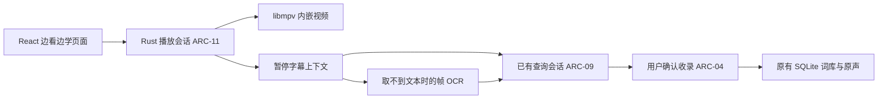

# SubtitleVocabularyList 边看边学设计

| 项目 | 内容 |
| --- | --- |
| 文档编号 | DOC-DES-WATCH-001 |
| 文档版本 | 0.1 |
| 更新日期 | 2026-10-21 |
| 状态 | 产品流程与 mpv/libmpv 内嵌选型已确认；工程方案待原型验证，尚未实现 |
| 需求依据 | [PRD §3.7、§5.7、FR-25 至 FR-29](../requirements/PRD.md) |
| 架构依据 | [DEC-08、ARC-11](architecture.md) |
| 开发与验证 | [开发计划](../planning/watch-and-learn-plan.md)、[TC-59 至 TC-63](../testing/test-plan.md#34-边看边学正常场景仅计划未执行) |

## 1 目标与边界

主流程是“打开视频 → 正常观看 → 不懂时空格暂停 → 读取字幕并翻译 → 按需查词／收录 → 继续观看”。播放器嵌入本软件，采用 libmpv 播放核心，沿用 Tauri／React／Rust／SQLite。用户无需启动 PotPlayer、外部 mpv 窗口，或先完成预习、全片识别、整集中文准备。

首版面向本地视频，提供打开、播放／暂停、定位、音量、音轨／字幕选择、加载外置字幕、字幕延迟和全屏。在线影视平台、DRM、播放器插件市场、自动整季翻译、自动生词判定、自动收录及自动出题不在本轮范围。现有预习和后台准备功能保留，由用户按原规则使用。

## 2 页面与交互

| 状态 | 默认呈现与操作 |
| --- | --- |
| 未打开视频 | “打开视频”，以及存在时的继续观看入口；不展示导入候选词或模型准备表单 |
| 观看中 | 视频为主体，紧凑播放控制；学习面板收起，设置按需展开 |
| 用户暂停 | 视频保持当前帧，旁侧显示原字幕、时间位置、文字来源和流式中文译文；点词或拖选短语可查看语境解释 |
| 准备收录 | 明确选择单词／短语／整句，预览释义、例句和可用原声后确认；取消返回暂停位置 |
| 继续播放 | 收起学习面板，撤销当前显示订阅；晚到结果不能覆盖下一次暂停内容 |

侧栏增加“边看边学”作为推荐观剧入口，原“观看前预习”保留为可选入口。初始显示上次位置，用户点“继续观看”才开始播放；新文件也由用户启动播放。不自动改动预习选集或听读进度。

Space 仅在播放器获得键盘焦点时切换播放／暂停；文本编辑、收录输入和按钮遵守自身键盘规则，不注册全局空格。原生视频区域和 React 控制都路由到同一暂停入口，避免 mpv 默认键位与应用各处理一次。全屏由应用控制，暂停后仍能访问学习面板，退出全屏不丢失播放位置。

自动翻译只响应用户发起的观看暂停。缓冲、加载、拖动进度、切页、最小化及程序内部暂停不触发查询。重复 pause 属性通知只处理一次；暂停时支持手动重查。此处查询、OCR 和普通播放在当前页面反馈，不逐次生成后台任务历史，沿用 NFR-03。

## 3 模块组织与原生嵌入

### 3.1 嵌入方案提案

首选在 Tauri 主窗口内创建由应用持有的原生视频子 HWND，通过 libmpv `wid` 嵌入；Rust 调用 C API，React 负责视频区域之外的控制和学习面板。首版只维持一个活动视频会话，播放操作与事件处理不占用界面线程。

原生视频与 WebView 有层叠限制，不能假定普通 DOM 浮层可以盖在视频上。布局为“视频区域＋旁侧学习面板”，窄窗口改为上下排列；面板展开时调整视频区域，避免遮挡画面。打开既有收录模态框时隐藏原生视频子窗口，保持暂停，关闭后恢复；不允许视频盖住确认按钮。页面固定工作区，面板独立滚动。

视图区以页面逻辑坐标报送，由宿主转换为物理坐标；窗口缩放、全屏、隐藏和恢复统一更新子窗口。HWND 创建、移动和销毁回到宿主线程；mpv 回调仅投递事件。M-20 必须用真实 Tauri 窗口完成一次嵌入、缩放和面板操作，才能锁定此方案；若原生层叠不满足要求，改评估 libmpv render API，仍保持应用内嵌，不把外部播放器窗口作为交付替代。

### 3.2 状态与生命周期

`PlayerSession` 持有 libmpv handle、媒体标识、播放位置、轨道和暂停来源；`PausedContext` 是本次暂停的不可变快照。建议实现位置为 `src-tauri/src/player/` 与前端 `WatchView`／`useWatchSession`；这是职责提案，当前尚无对应实现。

观察文件加载、pause、time-pos、轨道、字幕及延迟变化；进度显示合并通知，不逐帧发 IPC 或查库。暂停请求成功且位置稳定后读取上下文；处理前后核对同一文件、轨道和暂停版本。退出页面或最小化到托盘时暂停、隐藏视频并保存位置，返回时保持暂停；完全退出释放 libmpv。原有任务和同步按原生命周期运行。

暂停上下文至少包含 `playerSessionId`、`contextRevision`、媒体标识、暂停位置、学习字幕轨、字幕延迟、原文、文本来源和可用的对白起止时间。换文件、跳转、继续播放、切换字幕轨或改变延迟均使旧上下文失效；重新框选或编辑原文形成新修订。字幕、OCR、模型进度及收录预览返回时核对版本，避免把上一句结果拼到下一句；已打开的收录草稿冻结来源，不被播放器变化静默覆盖。

## 4 暂停后的文本取得

### 4.1 优先级

1. **播放器当前文本字幕**：读取所选学习字幕轨的 `sub-text`／第二字幕文本及对应起止位置。清理样式控制，不丢失对白内容；内封和外置文本字幕使用同一流程。
2. **同源已保存对白**：播放器没有可读文本，但已有该视频、该字幕版本的可靠对白索引时，按播放位置匹配并复用；包括用户此前核对过的图片字幕 OCR 结果。只按剧名相同不得建立关联。
3. **当前帧字幕 OCR**：没有可用字幕文字且画面中有字幕时，识别暂停帧的字幕区域。无字幕画面不凭空产生原文，不自动启动全片语音识别。

双字幕可指定用于学习的英文轨，默认优先已选英文文本轨；不擅自改变用户的显示轨。无法判断语言时让用户选一次。双语同轨保留原始文字，明确选取英文部分供学习，不能把中文字幕当英文词条。

字幕延迟只换算一次；原始字幕时间和播放器展示时间的对应规则在 M-20 依固定构建实测锁定。当前字幕已消失时，可采用同一轨最近结束且距暂停不超过 3 秒的上一句，必须标注“上一句”及其真实位置；3 秒是初始交互参数。超过窗口显示“此处无字幕”，提供上一句选择或重新框选，不自动把远处对白归给当前画面。当前位置空白本身不代表字幕提取故障。

### 4.2 OCR 保底

由 libmpv 异步截图接口取得**含可见字幕的暂停视频帧**，等待截图命令完成后交给已有本地 OCR；不截整个桌面，不再次弹出全屏截屏窗口。首次使用默认字幕下方区域，结果为空或区域不合适时，在应用内帧预览重新框选。黑边字幕、坐标换算及截图模式在 M-22 以一个真实样本核对。

显示 OCR 原文并允许纠错后重查；保留文字来源和修订，不让模型静默“纠正”对白。模型超时、词义解析失败或译文为空都属于查询问题，**不以 OCR 重读替代诊断**。截图与临时 OCR 产物放在现有 `Data` 临时任务目录，完成或取消后释放；只有明确保存需要的资料才进入长期存储。

OCR 只有帧时间时标记为“采集位置”，不冒充对白的完整起止。无可读文字时允许手动输入、加载字幕或直接继续播放。

## 5 翻译、查词与资源调度

整句自动查询使用已有 QueryRuntime 的 `translate` 模式；点词／选短语使用 `explain`，附当前原句作为语境。缓存命中先展示；单词沿用 Google 高频底库 → ECDICT → 本地模型顺序，语境解释按已有规则补充。词典命中不能冒充整句译文或当前语境已核实的词义。

复用现有流式进度、取消、最终中文结果校验和错误诊断。完整有效结果按既有规则缓存；流式中间片段仅作显示，不能直接成为已确认释义或可提交的收录内容。模型不可用时原字幕、已有解释和播放仍可用，显示可操作的重试原因，不自动转外网。外部查询仍由用户明确发起。

交互查询接入现有 ModelGate，遵守用户并发上限并优先于尚未开始的批量准备；不另起无上限线程池，不为每次暂停扫描整集，不自动取消已有后台任务。开始新的播放器原声前停止本应用其他正在播放的学习音频；听读／测验继续操作时播放器先暂停，避免两路声音叠加，不修改原答题和练习状态。

## 6 按需收录与旧功能共存

### 6.1 统一提交

从暂停上下文选择目标，经现有 `collection_prepare`／`collection_commit` 保存，复用草稿、匹配建议、人工修改、幂等操作标识、合并和学习规则，不建第二套单词本。播放、暂停、查询和关闭面板均不自动收录、不增加重复学习次数、不记录测验通过。

保存内容包括目标、中文解释、原句／译文、视频来源、字幕轨／文字来源及可用时间。已有词条追加对应例句、原声和本次主动收录历史，保留旧人工释义与学习记录。视频只播放不收录时，不创建全片候选和来源出现记录；确认收录时才创建／复用需要的轻量来源与例句。

已有导入来源以媒体指纹、轨道标识和时间映射绑定；仅路径或标题相似不够。新的视频来源应能在后续显式导入时复用，不能把轻量来源假报为“已完成全片导入”。这些内部绑定不改变既有来源 ID、已保存例句和同步协议的完整内容。

### 6.2 原声

字幕具有可靠起止时间时，复用 FFmpeg 截取及原声预览／保存能力，确认后保存到应用管理的媒体目录。OCR 仅有帧时间时，先提供用户可调整、试听的片段区间；未经确认不把推测区间标为精确对白原声，也允许只保存文字。语音兜底继续标为 Windows 生成语音。

确认保存的原声独立于视频原路径，后续移动视频不破坏已存音频；未收录缓存按已有回收规则处理。词条、例句、原声和学习历史继续遵守 FR-12，不缩减同步范围。

### 6.3 共存规则

| 现有功能 | 新模块接入规则 |
| --- | --- |
| 观看前预习、整集导入 | 原入口和数据保持；可从已有剧集打开播放器，直接播放也不要求先导入 |
| 后台中文准备 | 原任务、配置和已保存结果保持；暂停查询不发起整季／整集准备 |
| 我的单词本、复习、易忘词 | 仅确认收录后按现有规则进入；观看进度与测验掌握状态分别保存 |
| 听读练习、水平测试 | 独立会话、草稿和成绩保持；切页暂停视频，防止同时播放 |
| Alt+C／Alt+E／Alt+D、小窗、翻译替换 | 原快捷键和跨应用行为保持；播放器空格不占用全局快捷键 |
| 站点同步、资料目录 | 原协议和 `Data` 位置保持；播放位置首版本机保存，不新增站点接口 |

## 7 数据、接口与故障处理提案

### 7.1 持久化

在现有个人 SQLite 内增加轻量 `watch_playback_state`，记录媒体标识、路径提示、位置、音轨、字幕轨、延迟、字幕区域及更新时间；需要时增加与已有导入来源的绑定。迁移编号在实施时按当前 schema 递增，不在文档阶段占用版本。观看位置是本机播放偏好，首版不作为学习历史同步。

文件移动后提示重新定位并核对媒体身份；已有词条和原声保持。暂停快照保存在会话内存，翻译沿用现有查询缓存，确认收录沿用现有业务表。不得保存半句流式结果为完成资料，也不因缓存清理删除已收录的内容。

### 7.2 拟新增命令

以下预留 CMD-63 至 CMD-70，**尚未注册或生成类型**。详细字段在实现时通过现有 Rust DTO／前端类型生成链维护，参数沿用 camelCase。

| 编号 | 命令提案 | 输入与输出边界 |
| --- | --- | --- |
| CMD-63 | `watch_open` | 本地路径、可选已导入来源 → PlayerSnapshot；创建媒体会话，先就绪不自动播放 |
| CMD-64 | `watch_state_get` | 可选 sessionId → 当前 PlayerSnapshot／PausedContext，不触发查询 |
| CMD-65 | `watch_control` | sessionId、动作与参数 → 新快照；播放、用户暂停、定位、音量、轨道、外置字幕及延迟，经核心分派并记录动作来源 |
| CMD-66 | `watch_viewport_set` | sessionId、逻辑矩形、缩放和可见性 → 确认；宿主处理 HWND，不写业务资料 |
| CMD-67 | `watch_context_prepare` | sessionId、expectedContextRevision → 暂停上下文；按字幕／索引／OCR 顺序取原文，同版本复用 |
| CMD-68 | `watch_ocr_retry` | sessionId、expectedContextRevision、帧内选区 → 更新后的 OCR 上下文；不改旧收录 |
| CMD-69 | `watch_collection_prepare` | 上下文版本、选中目标、可选已确认音频区间、operationId → 现有 CollectionDraft；随后用 CMD-09 确认 |
| CMD-70 | `watch_close` | sessionId → 确认；保存位置、撤销会话工作并释放播放器 |

查询继续使用 CMD-38 至 CMD-41 等已有 translation 会话命令，在来源枚举中明确新增 watch 并关联上下文版本。`watch_updated` 只通知会话及版本，界面读取完整快照；流式事件沿用 query_updated，界面同时核对查询输入版本与播放器上下文版本。音频区间编辑在草稿预览内完成，不新增独立音频任务系统。

### 7.3 错误与可继续路径

| 情况 | 页面行为 |
| --- | --- |
| libmpv 资源缺失／媒体加载失败 | 显示具体原因，允许重选或关闭；已有单词本和学习功能仍可使用 |
| 没有当前字幕／图片字幕无文本 | 按第 4 节处理，明确文本来源；无字画面允许跳过 |
| OCR 为空或有错字 | 重新框选、编辑原文或取消，不把错误文字自动写入个人词库 |
| 模型失败或中文不合格 | 显示原文和可查看的原因，重试当前查询；不伪装成“播放器无字幕” |
| 查询期间继续播放或换文件 | 撤销旧订阅，禁止旧结果更新当前页面；已确认保存的资料保持 |
| 收录失败 | 保留草稿并沿用原幂等重试，播放器仍暂停 |

这些是实现行为约束，不代表已经执行异常或兼容测试。

## 8 资源交付与技术待验证项

libmpv 及依赖作为应用资源随将来明确要求的打包流程分发，不依赖用户安装播放器、不在首次播放时临时联网下载。应用资源位于安装目录，所有配置、缓存和运行数据位于同一目录下 `Data`；显式控制 mpv 配置和脚本加载，避免读取 AppData 或外部用户配置。保持用户自选安装位置和现有双底库／个人资料升级规则。

M-20 锁定 Windows 构建来源、版本、摘要、C API／渲染方式及所需 DLL。mpv 默认许可与可选 LGPL 构建不同，须按实际二进制及依赖核对许可证和对应源码交付；不能把 `client.h` 的头文件许可当成整个播放引擎许可。项目 GPL-3.0-only 保持。本轮不下载二进制、不生成安装包、不声称任意视频／HDR／显示器均已兼容。

| 待验证项 | 完成阶段与输出 |
| --- | --- |
| HWND 嵌入、层叠、焦点、全屏与模态框可用 | M-20 的一个真实窗口正常路径及采用的渲染方案 |
| 当前字幕、第二字幕及延迟后的时间对应 | M-20／M-21 的一个已知时间文本字幕样本记录 |
| 含字幕帧截图、字幕区域与 OCR | M-22 的一个图片字幕或硬字幕样本记录 |
| 来源复用、原声保存与观看位置迁移 | M-23／M-24 的最小正常记录；不自动扩展为迁移或兼容矩阵 |

## 9 需求追溯与资料依据

| 需求 | 主要设计 | 阶段／验收 |
| --- | --- | --- |
| FR-25 | 第 2、3、8 节：内嵌播放与低干扰观看 | M-20、M-24／TC-59、TC-63 |
| FR-26 | 第 3、4 节：暂停与可靠字幕上下文 | M-21／TC-60 |
| FR-27 | 第 5 节：流式翻译与按词查询 | M-21／TC-60 |
| FR-28 | 第 4 节：帧 OCR、纠错和来源标识 | M-22／TC-61 |
| FR-29、FR-05 至 FR-07、FR-12 | 第 6、7 节：明确确认、原声、合并与共存 | M-23、M-24／TC-62、TC-63 |

技术可行性依据核对于 2026-10-21，具体采用版本仍需锁定。这些官方接口资料不替代本项目的嵌入、字幕时钟或播放验证：

- [mpv 官方手册](https://mpv.io/manual/stable/)：嵌入、字幕属性及截图命令；图片字幕通常没有可读 sub-text。
- [libmpv C API](https://github.com/mpv-player/mpv/blob/master/include/mpv/client.h)：属性观察、异步命令及事件。
- [mpv 许可说明](https://github.com/mpv-player/mpv/blob/master/Copyright)：实际构建与依赖许可需要分别核对。

## 10 修订记录

| 版本 | 日期 | 内容 |
| --- | --- | --- |
| 0.1 | 2026-10-21 | 按已确认的 mpv/libmpv 内嵌与“边看边学”流程建立设计；区分现有能力复用、工程提案和未验证项 |
