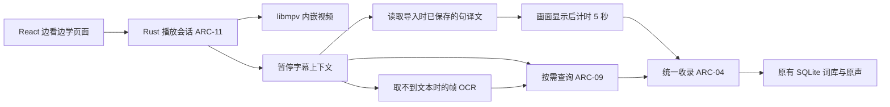

# SubtitleVocabularyList 边看边学设计

| 项目 | 内容 |
| --- | --- |
| 文档编号 | DOC-DES-WATCH-001 |
| 文档版本 | 0.19 |
| 更新日期 | 2026-10-22 |
| 状态 | 本轮开发按用户接受结束；后台证据及未实测交互／真实服务边界保留，后续按缺陷修复 |
| 需求依据 | [PRD §3.7、§5.7、FR-25 至 FR-29](../requirements/PRD.md) |
| 架构依据 | [DEC-08、ARC-11](architecture.md) |
| 开发与验证 | [开发计划](../planning/watch-and-learn-plan.md)、[TC-59 至 TC-64](../testing/test-plan.md#34-边看边学正常场景) |

## 1 目标与边界

主流程是“打开视频 → 正常观看 → 空格暂停 → 画面自动显示导入时保存的当前句译文 → 显示后持续暂停 5 秒则自动收录整句，提前播放则取消 → 继续观看”。手动查词／收录仍可用。播放器嵌入本软件，采用 libmpv 播放核心，沿用 Tauri／React／Rust／SQLite；无需启动外部播放器，也不要求完成全片准备才能观看。

首版面向本地视频，提供打开、播放／暂停、定位、音量、音轨／字幕选择、加载外置字幕、字幕延迟和全屏。自动收录只覆盖第 6.4 节定义的暂停整句，不扩展为整片候选入库。在线影视平台、DRM、播放器插件市场、自动整季翻译、自动生词判定及自动出题不在本轮范围。现有预习和后台准备功能保留，由用户按原规则使用。

### 1.1 当前实现范围

0.9.0 先完成内嵌、已有译文及定时收录，0.10.0 增加本地双语字幕。0.11.0 接入当前主／第二文字字幕、按需流式查询及帧 OCR 核对，0.12.0 接入音频互斥，0.13.0 接入在线字幕及人工偏移。代码位于 `player/{mod,mpv}.rs`、`watch.rs`、`WatchView/WatchQuery/WatchOcr.tsx`、`audioFocus.ts`。新增核心正常结果及待人工操作见[专项结果第 5 节](../testing/watch-and-learn-results.md#5-0110-后台开发增量)。实际交互及真实在线服务未实测边界保留；2026-10-21 用户接受结束本轮，不再据此阻塞开发，后续问题按缺陷修复。发行资源执行仍等明确发布请求。

运行与验证边界唯一记录于[专项结果](../testing/watch-and-learn-results.md)。开发版资源已锁定；发行资源许可材料、随包接入及安装验收留到明确发布请求，不在本轮生成安装包。

双语字幕见[独立设计](subtitle-import.md)：本地文本双轨与中文时间复用已接入，在线补缺已接入 SubDL 官方契约、版本核对及偏移，下载后正常数据流程通过，真实服务待用户配置后确认。

### 1.2 0.11.0 实际适配

- 暂停优先读 mpv 的 `sub-text/sub-start/sub-end`，再读第二字幕；没有可靠当前文字时，只有匹配原导入轨才回退到同源索引。原字幕 cue 时间用于中文对应，媒体时间按字幕延迟／速度换算后用于原声，二者分别保留。不同帧率与字幕特殊格式尚无兼容矩阵证据。
- 直接播放不创建全片候选。手动创建收录草稿或定时保存获准后，按打开时核对的媒体摘要创建／复用轻量 video 来源，写入需要的例句。该来源没有 corpus，不冒充完成整片预习导入；日后显式导入可复用同一默认媒体身份。精确对白原声复用 FFmpeg，按当前音轨截取，文件保存后与原路径分离。
- 查询复用 CMD-38 至 CMD-41 和 ModelGate，新增独立 `watch` owner，不改变小窗当前输入。只选已启用本地 Qwen；点词或选短语查释义，缺译文点“翻译当前句”。`watch_query_updated` 发给主窗口，流式预览可显示但不计时；ready 后保存有效句缓存，再由原生译文绘制确认启动完整 5 秒。继续、定位、换轨、离页会使旧版本失效并撤销订阅。
- 无可靠文字时用 `screenshot-raw subtitles` 保存冻结视频帧，包含原字幕、不包含应用译文／OSC；后台复用英语 Tesseract，不产生逐次任务历史。界面可在帧图内拖选、重新识别、编辑并确认原文。未确认前不建立可自动保存上下文；确认后的 OCR 只有采集点，无对白起止，自动及默认手动收录仅存文字，不伪造精确原声。原帧与裁剪图在上下文失效／识别结束时清理。

上述读取接口依据 [mpv 官方手册](https://mpv.io/manual/stable/)；时间换算核对了上游 `player/command.c` 与 `sub/dec_sub.c` 的字幕时间接口。模型失败保留原错误，不触发 OCR 掩盖翻译问题。

## 2 页面与交互

| 状态 | 默认呈现与操作 |
| --- | --- |
| 未打开视频 | “打开视频”，以及存在时的继续观看入口；不展示导入候选词或模型准备表单 |
| 观看中 | 视频为主体，紧凑播放控制；学习面板收起，设置按需展开 |
| 用户暂停、译文未显示 | 视频保持当前帧，读取当前原句和导入时保存在本地的译文；缺项明确提示，此时不倒计时 |
| 译文已显示 | 画面下方显示当前句译文，紧凑提示“5 秒后自动收录／本次不收录”；点词或选短语可查看解释，完整译文实际显示后才计时 |
| 自动收录完成 | 保持暂停位置，简短显示“已自动收录”，不弹确认窗；重复通知不再收录 |
| 手动准备收录 | 取消本次自动提交；选择单词／短语／整句，预览后确认，取消返回暂停位置 |
| 继续播放 | 未到时则取消自动收录，移除暂停译文、收起面板并撤销显示订阅；旧结果不能覆盖下次暂停内容 |

侧栏增加“边看边学”作为推荐观剧入口，原“观看前预习”保留为可选入口。初始显示上次位置，用户点“继续观看”才开始播放；新文件也由用户启动播放。不自动改动预习选集或听读进度。

窗口模式下 Space 在播放器获得键盘焦点时切换播放／暂停；全屏时软件窗口内的非编辑区域也按播放器意图处理 Space。文本编辑和收录输入保留自身规则，不注册系统全局空格。原生视频区域和 React 控制都路由到同一暂停入口，避免 mpv 默认键位与应用各处理一次。全屏由应用控制，暂停后仍能访问学习面板，退出全屏不丢失播放位置。

0.16.7 修复软件按钮进入全屏后的焦点遗漏：WatchView 在观察到进入全屏时先聚焦视频 DOM；Actor 在宿主全屏状态从 false 变为 true 时，通过宿主线程把焦点交给原生视频 HWND，沿用 mpv 默认按键处理。WebView 的 document 捕获阶段对全屏 Space 保底转到已有 toggle，preventDefault／stopPropagation 防止空格再次激活残留的软件按钮或重复进入视频元素 handler；过滤 repeat、组合输入、Ctrl／Alt／Meta、编辑控件和收录弹框。不改变系统快捷键或在普通页面拦截空格。

自动显示及收录只响应用户发起的观看暂停。缓冲、加载、拖动进度、切页、最小化及程序内部暂停不触发倒计时。重复 pause 属性通知只处理一次；暂停时优先读保存的译文，不默认重发模型请求，缺项可手动补充。查询、OCR 和每次定时保存仅在当前功能反馈，不逐次生成后台任务历史，沿用 NFR-03。

## 3 模块组织与原生嵌入

### 3.1 已采用的嵌入与字幕位置方案

0.16.4 起将 Tauri 主窗口内应用持有的视频子 HWND 通过 `wid` 交给完整 mpv 的原生视频输出。仍由 libmpv C API 内嵌同一引擎，不另造播放器内核或启动外部播放器窗口；`vo=gpu-next,gpu`、`gpu-api=d3d11`、`hwdec=auto-safe`，由 mpv 的原生 VO／Windows 窗口线程负责帧调度、硬件解码互操作、绘制、缩放和交换链。应用 Rust 线程只接收控制、观察状态及处理学习，React 负责视频之外的界面。取消旧应用 WGL／render API、逐帧 SwapBuffers 和合成器等待。没有使用低画质 profile 或降低输入视频分辨率；不对未经比较的 PotPlayer 默认锐化／色彩效果作结论。

此次调整依据[固定版本 render API 线程约束](https://github.com/mpv-player/mpv/blob/e471496c56/include/mpv/render.h)：旧代码将同步 C API 属性／命令与渲染放在同一线程，属于官方明确提示可能发生超时、降低播放质量的使用方式。原生输出让 mpv 自己完成这部分线程管理；不是另写一个绘制线程继续承担成熟播放器的职责。

原生视频与 WebView 有层叠限制，不能假定普通 DOM 浮层可以盖在视频上。暂停译文使用 libmpv 原生文本 OSD，靠近原字幕显示；原字幕位于人物附近、顶部或底部时均按其实际位置排布，恢复播放即移除。暂停后读取同一帧的 `screenshot-raw video` 与 `subtitles`，比较原字幕图层实际像素边界，并按视频显示比例／黑边换算到宿主坐标；不强制改变源字幕位置。译文优先置于字幕下方，空间不足则置于上方，并约束水平边缘。缩放／全屏重新计算；没有可测字幕边界（如上一句已消失）才用保底区域，不声称取得了不存在的字幕坐标。默认显示已保存完整译文；用户主动补充时可预览流式片段，但片段不开始计时，完整有效译文实际呈现后才计时。ASS 控制转义后呈现，不改写源字幕文件。查词、时间来源及倒计时操作位于紧凑控制区／旁侧面板，窄窗口改为上下排列。打开既有收录模态框时隐藏原生视频子窗口并取消本次自动计时，保持暂停；关闭后不自动重启计时。页面固定工作区，面板独立滚动。

视图区以页面逻辑坐标报送，由宿主转换为物理坐标；窗口缩放、全屏、隐藏和恢复统一更新宿主子窗口，mpv 自己跟随其尺寸。HWND 创建、移动和销毁回到宿主线程。普通播放无应用绘制循环和逐帧截图。暂停译文完整提交后保守等待至少 50 ms，再通过原生 VO 的同步合成帧读取及一次 DWM 同步完成学习侧确认，此时才交给单调时钟；没有完整译文、未暂停或不可见时均不开始 5 秒计时。50 ms 不是 5 秒的一部分，也不单独当作显示完成凭据。这一后台输出确认不等于实际物理屏幕已人工验收；真实窗口显示时机仍需按 TC-59／63 核对，不把后台截图当作物理屏幕呈现证据。

全屏隐藏侧栏／标题／打开工具栏及 React 底部控制／学习面板，视频区域占满窗口；使用 mpv 内置 OSC 叠加浮动控制，鼠标移动显示、停止后隐藏，不为控制条保留画面外空间。外部配置／脚本自动加载保持关闭。倒计时／保存结果用短暂原生 OSD，Esc 返回时取消尚未到期计时。播放、音量、定位、轨道和字幕快捷键交给 mpv 默认绑定及内置 OSC；Windows 内嵌的 mpv 子窗口由上游禁用直接输入，宿主保留已有薄输入转发、右键菜单、拖放队列及全屏同步，不自行重写默认播放绑定。F11 为宿主全屏入口，q／Q 关闭当前视频并保存进度，不结束单词本。

0.16.6 增补鼠标停止：普通窗口的紧凑播放工具区显示“■ 停止播放”，原生右键菜单顶层显示同名动作；mpv 内置 OSC 通过其 `custom_button_1_content`／`custom_button_1_mbtn_left_command` 配置增加右侧“■”按钮，普通与全屏均随原生控制条浮现，不新建绘制层或播放控件。按钮发送 `script-message svl-stop`，Actor 接收 CLIENT_MESSAGE 后调用同一个 `watch_control close`；配置依据[固定上游 OSC 源码](https://github.com/mpv-player/mpv/blob/e471496c56/player/lua/osc.lua)。停止先保存当前位置，取消旧查询／OCR／倒计时，执行 mpv stop，立即清除 playing 和当前文件状态，将原生与宿主全屏同步关闭；播放列表保留。快捷键继续使用同一路径，不退出单词本。

0.16.7 将窗口入口明确命名为“⚙ 播放器设置”，原生 OSC 的 custom_button_1 改为齿轮并发送 `svl-settings`，停止移到 custom_button_2、仍位于最右侧。Actor 接到设置请求后打开已有 Windows 原生播放菜单，与窗口按钮／右键共用倍速、声音／音轨、字幕及循环参数；偏好和逐文件轨道沿用现有持久化，不新增配置文件或重写 mpv 设置系统。菜单期间仍取消未到期的自动收录。libmpv 的参数配置与本应用提供的菜单入口分别说明，不把引擎集成当作已带入完整桌面设置窗口。

### 3.2 状态与生命周期

`PlayerSession` 持有 libmpv handle、媒体标识、播放位置、轨道和暂停来源；`PausedContext` 是本次暂停的不可变快照。实现位置为 `src-tauri/src/player/`、`watch.rs` 与前端 `WatchView`；OCR／查询实现与后续人工验收分别见专项结果。

观察文件加载、pause、time-pos、轨道、字幕及延迟变化；进度显示合并通知，不逐帧发 IPC 或查库。暂停请求成功且位置稳定后读取上下文；处理前后核对同一文件、轨道和暂停版本。退出页面或最小化到托盘时暂停、隐藏视频并保存位置，返回时保持暂停；完全退出释放 libmpv。原有任务和同步按原生命周期运行。

暂停上下文至少包含 `playerSessionId`、`contextRevision`、媒体标识、暂停位置、学习字幕轨、字幕延迟、原文、文本来源和可用的对白起止时间。换文件、跳转、继续播放、切换字幕轨或改变延迟均使旧上下文失效；重新框选或编辑原文形成新修订。字幕、OCR、模型进度及收录预览返回时核对版本，避免把上一句结果拼到下一句；已打开的收录草稿冻结来源，不被播放器变化静默覆盖。

自动收录另保存本次暂停标识、译文及其版本、显示确认时间、倒计时状态和稳定收录操作标识。计时起点是当前完整译文在可见画面上实际显示的确认，不能使用 pause 时间、HTTP／数据库返回时间或首个流式字符时间替代；显示失败或窗口隐藏时不进入倒计时。OSD 命令成功不等于已经呈现，M-20／M-21 需明确实际渲染与显示确认方式。

## 4 暂停后的文本取得

### 4.1 优先级

1. **播放器当前文本字幕**：读取所选学习字幕轨的 `sub-text`／第二字幕文本及对应起止位置。清理样式控制，不丢失对白内容；内封和外置文本字幕使用同一流程。
2. **同源已保存对白**：播放器没有可读文本，但已有该视频、该字幕版本的可靠对白索引时，按播放位置匹配并复用；包括用户此前核对过的图片字幕 OCR 结果。只按剧名相同不得建立关联。
3. **当前帧字幕 OCR**：没有可用字幕文字且画面中有字幕时，识别暂停帧的字幕区域。无字幕画面不凭空产生原文，不自动启动全片语音识别。

双字幕可指定用于学习的英文轨，默认优先已选英文文本轨；不擅自改变用户的显示轨。无法判断语言时让用户选一次。双语同轨保留原始文字，明确选取英文部分供学习，不能把中文字幕当英文词条。

字幕延迟只换算一次；原始字幕时间和播放器展示时间的对应规则在 M-20 依固定构建实测锁定。当前字幕已消失时，可采用同一轨最近结束且距暂停不超过 3 秒的上一句，必须标注“上一句”及其真实位置；3 秒是初始交互参数。超过窗口显示“此处无字幕”，提供上一句选择或重新框选，不自动把远处对白归给当前画面。当前位置空白本身不代表字幕提取故障。

### 4.2 OCR 保底

由 libmpv 异步截图接口取得**含可见字幕的暂停视频帧**，等待截图命令完成后交给已有本地 OCR；不截整个桌面，不再次弹出全屏截屏窗口。首次使用默认字幕下方区域，结果为空或区域不合适时，在应用内帧预览重新框选。黑边字幕、坐标换算及截图模式在 M-22 以一个真实样本核对。

显示 OCR 原文并允许纠错后重查；保留文字来源和修订，不让模型静默“纠正”对白。模型超时、词义解析失败或译文为空都属于查询问题，**不以 OCR 重读替代诊断**。截图与临时 OCR 产物放在现有 `Data` 临时任务目录，完成或取消后释放；只有明确保存需要的资料才进入长期存储。

识别帧不得包含本应用新叠加的译文／倒计时，以免将中文当原字幕再次识别；在叠加前取得原始暂停帧，或使用已核对的排除本应用 OSD 的截图路径。未核对的 OCR 原文不进入自动收录条件。

OCR 只有帧时间时标记为“采集位置”，不冒充对白的完整起止。无可读文字时允许手动输入、加载字幕或直接继续播放。

## 5 翻译、查词与资源调度

### 5.1 暂停默认读取已保存译文

按视频身份、字幕版本和当前对白位置取得导入／后台准备时已保存的整句译文，优先复用对应例句记录；原文和译文一起冻结为当前上下文。不能仅用相近时间或剧名匹配，也不拿单词通用解释当句译文。命中后直接展示，不重新请求模型，译文显示不依赖模型是否正在运行。

缺项显示“暂无已保存译文”，可点击“补充当前句译文”，或按原流程安排资料准备；不因一次暂停自动启动全片任务。直接打开未导入视频仍可播放，也可补充当前句，不强制先准备整集。补充成功的完整译文保存并显示后，再从零计满 5 秒；等待过程不追算。

### 5.2 按需补充与查词

补充整句使用已有 QueryRuntime 的 `translate` 模式；点词／选短语使用 `explain`，附当前原句作为语境。单词沿用 Google 高频底库 → ECDICT → 本地模型顺序，语境解释按已有规则补充。词典命中不能冒充整句译文或当前语境已核实的词义。

复用现有流式进度、取消、最终中文结果校验和错误诊断。完整有效结果按既有规则保存；流式中间片段可预览，但不启动自动收录计时，不成为可提交释义。模型不可用时原字幕、已有译文和播放仍可用，显示可操作的重试原因，不自动转外网。外部查询仍由用户明确发起。

交互查询接入现有 ModelGate，遵守用户并发上限并优先于尚未开始的批量准备；不另起无上限线程池，不为每次暂停扫描整集，不自动取消已有后台任务。开始新的播放器原声前停止本应用其他正在播放的学习音频；听读／测验继续操作时播放器先暂停，避免两路声音叠加，不修改原答题和练习状态。

## 6 按需收录与旧功能共存

### 6.1 统一提交

手动选词／短语／整句仍经现有 `collection_prepare`／`collection_commit` 确认保存。第 6.4 节的自动路径由核心用同一准备与提交事务保存整句，不弹出确认窗；复用匹配建议、幂等操作标识和合并规则，不建第二套单词本。普通查询、播放与短暂停顿不收录，任何观看操作都不记录测验通过。

保存内容包括目标、中文解释、原句／译文、视频来源、字幕轨／文字来源及可用时间。已有词条按原规则追加不同例句及原声，保留旧人工释义与学习记录；自动触发与手动主动收录分别标识，自动重放不累计主动重复学习。视频只播放不收录时，不创建全片候选；在手动确认或定时条件满足时才创建／复用需要的来源与例句。

已有导入来源以媒体指纹、轨道标识和时间映射绑定；仅路径或标题相似不够。新的视频来源应能在后续显式导入时复用，不能把轻量来源假报为“已完成全片导入”。这些内部绑定不改变既有来源 ID、已保存例句和同步协议的完整内容。0.13.2 修正旧显式选轨资料的播放身份核对：有字幕资产清单时按媒体 SHA-256；没有清单时优先核对纯媒体摘要，或用已保存 ImportedMedia 的选轨和当前文件摘要重算旧 video-options-v1 身份，复用补字幕已有核对函数。不把含导入选项的来源摘要直接当成文件 SHA-256，也不通过忽略身份冲突强行套用旧译文。核对成功不重写旧来源指纹、不重建个人资料；记录不足以证明匹配时仍明确报错，不声称支持全部旧资料变体。

### 6.2 原声

字幕具有可靠起止时间时，复用 FFmpeg 截取及原声保存能力，手动确认或自动提交时保存到应用管理的媒体目录；自动保存不发声、不影响视频继续播放。OCR 仅有帧时间时，0.13.1 在核对原文后提供默认折叠的“原声区间（可选）”：起止秒数初始为建议值，用户准备片段后用普通音频控件试听，不自动播放；明确“使用此片段”后，手动收录草稿采用该区间，仍须确认保存。调整区间会使旧选择和试听失效，可改回只存文字。核心用 `with_manual_clip` 创建独立草稿副本，地点标识附 `manual-clip:<start>:<end>`；不修改原 OCR 暂停快照，不触发自动保存，自动路径仍仅保存文字和采集位置。`preciseTiming=true` 在该副本中只表示已有人为选定的原声范围，不表示识别到了字幕起止，原 `textSource=frame_ocr` 保留。语音兜底继续标为 Windows 生成语音。

确认保存的原声独立于视频原路径，后续移动视频不破坏已存音频；未收录缓存按已有回收规则处理。词条、例句、原声和学习历史继续遵守 FR-12，不缩减同步范围。

### 6.3 共存规则

0.12.0 的 HTML 媒体捕获 play 事件，同窗口暂停其他媒体并广播 `audio_focus`，同时用 watch_control 的 audio_focus 使原生视频内部暂停。原生 playing 从 false 变为 true 时广播 owner=watch，各窗口暂停学习音频；不自动继续被暂停的会话。只改变播放状态，不修改课程／题目草稿或学习记录。0.13.1 已暂停时收到 audio_focus 只取消自动计时，保留当前原句、OCR 编辑和手动区间；正在播放时仍执行内部暂停并使播放上下文失效。此修正避免试听本句原声反而关闭编辑区；实际听感仍待人工确认。该路径代码与编译检查完成，真实跨窗口听感待人工验收。

| 现有功能 | 新模块接入规则 |
| --- | --- |
| 观看前预习、整集导入 | 原入口和数据保持；可从已有剧集打开播放器，直接播放也不要求先导入 |
| 后台中文准备 | 原任务、配置和已保存结果保持；暂停查询不发起整季／整集准备 |
| 我的单词本、复习、易忘词 | 手动确认或定时整句收录后按现有规则进入；重复自动触发不冒充主动遗忘，观看进度与测验状态分别保存 |
| 听读练习、水平测试 | 独立会话、草稿和成绩保持；切页暂停视频，防止同时播放 |
| Alt+C／Alt+E／Alt+D、小窗、翻译替换 | 原快捷键和跨应用行为保持；播放器空格不占用全局快捷键 |
| 站点同步、资料目录 | 原协议和 `Data` 位置保持；播放位置首版本机保存，不新增站点接口 |

### 6.4 译文显示后定时收录

“边看边学”设置提供 `autoCollectEnabled=true`、`autoCollectDelaySeconds=5`；5 秒由用户确认，时长可改为正数秒，开关／时长仅影响本模块。关闭、修改设置或点“本次不收录”立即取消当前计时，下次用户主动暂停再采用新配置，不自动重新激活已暂停内容。

| 状态 | 进入条件及处理 |
| --- | --- |
| waiting_translation | 用户主动暂停；取原文、读取已存译文或等待用户补充，均不计时 |
| counting | 原文及来源可靠、完整有效译文已在可见画面显示，且仍在同一处暂停；记录单调时钟 `translationVisibleAt`，从 5 秒开始 |
| cancelled | 显示后未满时长继续播放，或跳转／换轨／离页／隐藏／编辑内容／手动收录／取消；作废本次计时 |
| saving | 显示后持续满时长，核心再次核对开关、暂停、上下文与译文版本及未取消，冻结整句并交统一事务 |
| saved／already_saved | 显示简短结果；同一来源句已自动保存则复用，不重记例句／音频或主动收录次数 |

例如按下暂停后等了 8 秒译文才完整显示，**从第 8 秒重新计时**：第 11 秒继续播放只有 3 秒，不收录；保持暂停至第 13 秒才触发。数据库读取、OCR、网络／模型等待和流式未完成时间一律不折抵这 5 秒。已有译文直接显示也要等待完整 5 秒。

每次新的主动暂停建立独立计时；重复属性／显示通知不重置起点。内容修订后必须显示新完整译文，再重新开始一整段计时；仅从隐藏页返回、内部暂停或取消后仍留在原句，不自动重启。无完整译文、来源歧义或 OCR 未核对时提示原因，不静默保存。

计时与保存判定在 Rust 控制器，前端只展示剩余秒数；到时信号携带暂停／上下文／译文版本。播放与提交入口串行核对，恢复发生在期限前则取消，禁止迟到回调保存旧句。到时已经被核心接受的保存可在继续播放后完成，始终使用已冻结来源；当前页面反馈，不产生逐次后台历史。

自动操作标识由媒体、字幕版本、对白片段及原文摘要稳定派生，在现有幂等记录中持久保存；重启和再次暂停同一片段仍去重。不同来源例句按现有合并规则追加；手动再次收录沿用原主动历史逻辑。自动合并若有歧义，保留待手动选择，不盲目覆盖；失败保留原因与手动重试入口，不无限自动提交。

## 7 数据、接口与故障处理提案

### 7.1 持久化

本轮复用个人 SQLite `settings` 的 `watch:progress` JSON，记录来源、路径、位置、音轨／字幕轨和延迟；默认开关／秒数复用 Settings 的 `watchAutoCollect`／`watchCollectDelaySeconds`。不新建表，schema 仍为 10；字幕区域和新来源扩展在后续实际需要时再迁移。观看位置是本机播放偏好，首版不作为学习历史同步。

文件移动后提示重新定位并核对媒体身份；已有词条和原声保持。暂停快照与倒计时仅在运行期内存，重启不恢复未到时计时；译文优先读取既有例句／翻译持久化记录，补充查询仍用原缓存。自动收录设置保存在现有本机设置，去重记录与提交结果使用现有业务事务持久化，区分 `manual` 与 `watch_pause` 触发；若需增加字段，实施时生成同一 DTO 并保持旧数据／同步语义。不得保存流式片段为完成资料，也不因清理缓存删除已收录内容。

### 7.2 命令与实现状态

CMD-63 至 CMD-66、CMD-69、CMD-71 已注册并由现有 Rust DTO 链生成前端类型，参数用 camelCase。CMD-67／68／70 保留编号：上下文、OCR 和关闭合并在控制器动作内，不暴露同名独立命令。

| 编号 | 命令提案 | 输入与输出边界 |
| --- | --- | --- |
| CMD-63 | `watch_open` | 本地路径、可选已导入来源 → PlayerSnapshot；创建媒体会话，先就绪不自动播放 |
| CMD-64 | `watch_state_get` | 无参数 → PlayerSnapshot／WatchContext，含已存译文版本、显示状态及倒计时／保存结果；不触发模型查询 |
| CMD-65 | `watch_control` | action、value／text、可选 expectedRevision → 新快照；播放、用户暂停、定位、音量、轨道、字幕延迟及取消本次自动收录；记录动作来源，恢复播放作废未到时计时 |
| CMD-66 | `watch_viewport_set` | 逻辑矩形和可见性 → 确认；缩放由宿主读取，宿主处理 HWND，不写业务资料 |
| CMD-67（保留） | `watch_context_prepare` | 当前由暂停控制器按文字字幕／同源索引／帧 OCR 取得上下文 |
| CMD-68（保留） | `watch_ocr_retry` | 当前由 watch_control 的 ocr_crop（text 为 PixelRect JSON）及 confirm_ocr（text 为核对原文）处理，必须核对 expectedRevision |
| CMD-69 | `watch_collection_prepare` | sessionId、expectedRevision、可空 clipRange（startMs／endMs） → 绑定后的 WatchContext；只准备来源及例句，再用既有 collection_from_example／collection_prepare 建草稿及 CMD-09 确认 |
| CMD-70（保留） | `watch_close` | 当前由 watch_control 的 close 动作停止视频并保存位置，完全退出时释放引擎 |
| CMD-71 | `watch_progress_get` | 无参数 → 本机 WatchProgress 或 null；已注册 |

查询沿用 CMD-38 至 CMD-41，watch origin 的 locationKey 为 `playerSession:contextRevision`；更新事件为主窗口专用 `watch_query_updated`。watch_control 的 query_translation 只采用该暂停版本的整句查询，部分结果不计时，完成才写缓存并绘制。`watch_updated` 通知快照变化，`watch_collected` 通知已保存项刷新。OCR 默认只存文字；0.13.1 的可空 clipRange 只为已确认 OCR 的手动草稿绑定范围，核对当前暂停版本、视频时长及所选音轨，复用 preview_start、原声缓存和既有收录提交。自动控制器持有的 OCR 上下文保持不变。

设置复用现有本机设置读写入口，不增加独立命令。当前暂停译文的实际显示确认携带 sessionId、contextRevision、translationRevision；原生 OSD／React 适配回报可见呈现后才启动核心计时，不能因 `watch_context_prepare` 返回而提前开始。自动提交由控制器在条件满足时内部调用统一收录服务，不允许前端绕过倒计时直接提交任意旧字幕。

### 7.3 错误与可继续路径

| 情况 | 页面行为 |
| --- | --- |
| libmpv 资源缺失／媒体加载失败 | 显示具体原因，允许重选或关闭；已有单词本和学习功能仍可使用 |
| 没有当前字幕／图片字幕无文本 | 按第 4 节处理，明确文本来源；无字画面允许跳过 |
| OCR 为空或有错字 | 重新框选、编辑原文或取消，不把错误文字自动写入个人词库 |
| 模型失败或中文不合格 | 显示原文和可查看的原因，重试当前查询；不伪装成“播放器无字幕” |
| 查询期间继续播放或换文件 | 撤销旧订阅，禁止旧结果更新当前页面；已确认保存的资料保持 |
| 收录失败 | 保留草稿并沿用原幂等重试，播放器仍暂停 |
| 缺已保存译文／自动收录条件不足 | 明确标示缺项，不启动计时；补充并实际显示完整译文后从零计时 |
| 自动保存失败／匹配歧义 | 当前功能显示原因及手动处理入口，不反复自动提交、不覆盖旧词条 |

这些是实现行为约束，不代表已经执行异常或兼容测试。

## 8 资源交付与技术待验证项

libmpv 及依赖作为应用资源随将来明确要求的打包流程分发，不依赖用户安装播放器、不在首次播放时临时联网下载。应用资源位于安装目录，所有配置、缓存和运行数据位于同一目录下 `Data`；显式控制 mpv 配置和脚本加载，避免读取 AppData 或外部用户配置。保持用户自选安装位置和现有双底库／个人资料升级规则。

M-20 锁定 Windows 构建来源、版本、摘要、C API／渲染方式及所需 DLL。mpv 默认许可与可选 LGPL 构建不同，须按实际二进制及依赖核对许可证和对应源码交付；不能把 `client.h` 的头文件许可当成整个播放引擎许可。项目 GPL-3.0-only 保持。固定 DLL 版本及摘要见[组件记录](../../scripts/mpv-runtime-notice.md)。开发阶段未生成安装包；0.16.3 本机试用包接入情况见下文，不据此声称任意视频／HDR／显示器均已兼容。

固定资源身份由 [`scripts/mpv-runtime.json`](../../scripts/mpv-runtime.json) 统一记录。开发准备脚本读取清单并同时校验归档与 DLL SHA-256；目前固定 shinchiro 20261021／mpv e471496c56，DLL 为 Windows x86_64 `libmpv-2.dll`。0.13.0 仅核对现有开发 DLL 与清单，没有执行下载、重新解包或安装。

沿用既有人工打包入口，不另做播放器安装器；完整公开发行目标与本机试用接入分别记录：

| 环节 | 资源与检查 | 当前状态 |
| --- | --- | --- |
| 正式资源准备 | 校验固定归档和实际 DLL，写入 `.tools/release-resources/mpv/`，附固定版本清单、实际构建及各依赖许可 | 0.16.3 已准备 DLL、清单及 mpv 许可原文；完整静态依赖条款仍待补齐 |
| 打包前检查 | 在清理／编译之前核对 DLL 架构、版本摘要、依赖和对应源码材料；`-SkipToolBuild` 也不能略过缺失播放器资源 | 环境预检和正式清理前资源准备已接入，DLL／两份上游归档通过；完整静态依赖源码核对未完成 |
| Tauri 与独立目录 | 沿用现有 release-resources → tools 映射，包含 `mpv/libmpv-2.dll` 及清单／许可，安装后只从应用 tools 加载 | 0.16.3 已生成含播放器的 NSIS 和独立目录，未执行安装 |
| 源码材料 | 在既有源码资料 ZIP 中加入该二进制实际使用的 mpv、构建配方及依赖对应源码／补丁和配置，不能只附仓库链接或头文件 | 0.16.3 已加入固定引擎与提供方确切配方；静态依赖源码未完整收齐，不当作完整材料 |
| 升级保持 | 只更新 tools 下应用资源，Data 内字幕、词库、媒体及学习记录按既有规则保留 | 沿用既有设计，本轮未执行升级安装验收 |

上述表格保留完整公开发行目标。2026-10-22 用户明确请求 0.16.3 本机安装试用包，接入 `prepare-mpv-release.py`：根目录入口在 Cargo 清理之前准备固定资源、核对归档／DLL 摘要、PE x64 架构及实际 DLL 加载依赖；`-SkipToolBuild` 仅复用原六项媒体资源，仍准备播放器和底库。播放器及版本／许可文件纳入统一资源摘要、既有 Tauri 映射与独立运行目录；源码导出加入固定 mpv 引擎和确切提供方构建配方（含补丁／配置）。提供方使用移动依赖分支，完整静态依赖对应源码与条款尚未收齐，此本机试用交付不等同于表格中完整对外发行材料完成，不据此创建公开发行或版本标签。实际构建及未安装边界见[0.16.3 交付记录](../release/0.16.3-release-notes.md)。

| 待验证项 | 完成阶段与输出 |
| --- | --- |
| HWND 嵌入、层叠、焦点、全屏与模态框可用 | M-20 的一个真实窗口正常路径及采用的渲染方案 |
| 当前字幕、第二字幕及延迟后的时间对应 | M-20／M-21 的一个已知时间文本字幕样本记录 |
| 含字幕帧截图、字幕区域与 OCR | M-22 的一个图片字幕或硬字幕样本记录 |
| 来源复用、原声保存与观看位置迁移 | M-23／M-24 的最小正常记录；不自动扩展为迁移或兼容矩阵 |

## 9 需求追溯与资料依据

| 需求 | 主要设计 | 阶段／验收 |
| --- | --- | --- |
| FR-25 | 第 2、3、8 节：内嵌播放与低干扰观看 | M-20、M-24／TC-59、TC-63 |
| FR-26 | 第 3、4 节：暂停与可靠字幕上下文 | M-21／TC-60 |
| FR-27 | 第 2、5、6.4 节：保存译文画面展示、按需补充与显示计时 | M-21、M-23／TC-60、TC-64 |
| FR-28 | 第 4 节：帧 OCR、纠错和来源标识 | M-22／TC-61 |
| FR-29、FR-05 至 FR-07、FR-12 | 第 6、7 节：显示后 5 秒自动整句收录、手动确认、去重及共存 | M-23、M-24／TC-62 至 TC-64 |

技术可行性依据核对于 2026-10-21，已采用的固定版本见组件记录。这些官方接口资料不替代本项目的嵌入、字幕时钟或播放验证：

- [mpv 官方手册](https://mpv.io/manual/stable/)：嵌入、字幕属性、截图与文本 OSD；图片字幕通常没有可读 sub-text。叠加显示的具体呈现确认仍须本项目原型核对。
- [libmpv C API](https://github.com/mpv-player/mpv/blob/master/include/mpv/client.h)：属性观察、异步命令及事件。
- [mpv 许可说明](https://github.com/mpv-player/mpv/blob/master/Copyright)：实际构建与依赖许可需要分别核对。

## 10 播放列表、倍速与偏好增量（0.14.0）

依据 FR-32／33、M-28／29。沿用 mpv 原生 `loadfile append`、`playlist-play-index`、`playlist-next/prev`、`playlist-move/remove` 及原生 OSC／默认键；不另建播放、进度条或音频引擎。列表默认收起，多选及单层目录按数字文件名自然排序、同一路径去重，可上移／下移。打开导入资料沿用同一队列。`keep-open=yes` 实现顺序连播及最后一集停留，关闭连播使用 `always`；无自动片头／片尾跳过。接口语义依据 [mpv 官方手册](https://mpv.io/manual/stable/)。

原生 `START_FILE` 使旧学习版本失效，取消旧查询／OCR／倒计时并生成新会话；`on_load` 钩子在后台读取新文件的 WatchMedia、核对媒体身份及来源，完成后才放行文件加载。页面与原生快捷键／OSC 切集都经过这一入口；后台文件读取不阻塞 UI 线程。`FILE_LOADED` 先恢复导入选轨，再恢复该文件自己的进度及选轨；片尾不触发学习暂停。读取失败显示具体原因并停止本次播放，保留队列供用户处理。旧异步 OCR／翻译／回执仍核对会话和 revision。换集期间保留原生画面区域，避免 React 更新区域时产生内部暂停而中断连播。

0.16.5 的主动打开语义：`open`、列表 `select`／`restore`、空会话 `append` 和文件打开入口在选择目标后设置 mpv `pause=false`，沿用原生加载及进度／轨道恢复，不再要求第二次点击播放。初始化仍保持暂停，只有显式打开请求才开播；仅返回页面不恢复播放。视图区 effect 重建只撤销观察器，真正离开页面时才发送隐藏请求，避免打开文件引起几何订阅更新后反向暂停。收录弹框通过新的可见性更新照常隐藏并暂停。

`playback.rs` 定义 PlaybackState（playlist、currentPath、preferences）及目录扫描／自然排序；SQLite settings 的 `watch:playback` 保存队列及倍速、音量、静音、autoNext。原生键和 OSC 改变倍速／声音时由快照采样同步偏好；只在内容变化时写偏好。队列、当前路径可恢复，但不自动开播。倍速选择位于紧凑工具条，全屏保留纯视频与原生 OSC，快捷键变速显示短暂 OSD。

每个文件的进度存入 `watch:progress:<pathDigest>`；同时保留原 `watch:progress` 供旧的继续观看入口读取。旧记录可作为对应文件后备，不迁移或覆盖学习数据。正常播放每 5 秒保存一次，并在换集／隐藏／关闭时保存；退出保存与视频进度独立。音轨和主／第二字幕 ID 按文件保存，0 表示关闭；外置字幕路径仍可访问时重载。字幕延迟按文件恢复，首次观看新文件复位为 0；已到结尾（距片尾不足半秒）不恢复至结尾。播放偏好与队列均留在当前 Data，mpv 保持 `config=no`，不写 AppData 配置。

0.16.3 的 save_progress 同步更新内存中的最近进度，再持久化。文件卸载后 END_FILE／START_FILE 只能使用缓存，因此字幕、延迟及外置文件的即时保存必须同时刷新缓存，防止切集时把刚保存的设置覆盖成旧快照。

CMD-84 与 PlayerSnapshot 扩展见[接口设计](interfaces.md)。最小实际证据见[播放功能结果](../testing/playback-results.md)；后台正常检查不替代未执行的窗口操作，后续反馈按缺陷修复，不以人工确认阻塞开发。

## 11 常用播放控制（0.15.0）

依据 FR-34 至 FR-36、M-30 至 M-32。`player/menu.rs` 用 Windows 原生弹出菜单承载分组和当前勾选，所有选择回到已有 WatchControl／libmpv 命令；不重做播放条或视频渲染。菜单在主窗口线程创建、弹出和释放，视频线程继续处理 mpv；菜单请求及选中动作记录会话，视频变更后丢弃旧选择。主界面新增“播放设置”单入口，循环／A–B 非默认时才显示一行状态；全屏仍为纯视频，使用右键或菜单键。

宿主补齐垂直／水平滚轮、中键与侧键转发。滚轮屏幕坐标转宿主坐标，再映射为物理渲染坐标，步进按 Windows delta/120 传入 mpv `keypress` scale；修饰键保留，原生双击检测仍由 mpv 处理。右键改为应用菜单，Menu／Shift+F10 同路进入；其余键保留原生行为。原生输入能力依据[固定版本命令接口](https://github.com/mpv-player/mpv/blob/e471496c56/DOCS/man/input.rst)。

音轨与两路字幕使用 aid／sid／secondary-sid。快照分别反映主选和第二字幕选中；外置字幕选择统一通过主窗口文件对话框，提交核对 revision。sub-visibility、secondary-sub-visibility、sub-scale、sub-pos 和循环模式追加至 PlaybackPreferences，旧 JSON 用默认值读取；轨道和延迟仍沿用逐文件 WatchProgress。ASS 定位与图片字幕按 mpv 自身支持处理，不强制覆盖原样式。

调试命令 capture_frame 从 0.16.1 起请求当前 mpv 渲染器生成 window 合成截图，包含主／第二字幕和 OSD，避免读取可能为空白或过期的 GL_FRONT 缓冲。合成截图只能证明该渲染器的输出，不能单独证明实际屏幕呈现。后台正常检查复用产品的 Engine，在始终不可见的原生窗口中选择双字幕并核对解码文字及合成图；真实窗口验收另行记录。需求 FR-35 的显示行为和播放实现不因诊断方式改变，实际结果见[播放验证第 6 节](../testing/playback-results.md#6-0161-后台定位与调试取帧修复)。

指定时间直接调用 mpv 内置 console 的 `get-input`，由 client_name／带会话的 handler_id 接收 CLIENT_MESSAGE submit，解析为秒数后发绝对定位，不执行输入文本为命令。该协议依据[固定版本 console](https://github.com/mpv-player/mpv/blob/e471496c56/player/lua/console.lua)，无外部脚本或新运行时依赖。相对定位、sub-seek、chapter、loop-file、loop-playlist、ab-loop-a/b 均为 mpv 原生命令／属性。章节从 chapter-list 读取；菜单提示文字字幕的定位能力受 mpv 已读字幕范围限制。

显式循环模式互斥，列表循环启用 autoNext；关闭 autoNext 清除列表循环。显式模式切换清除 A–B，换集也清除 A–B，不持久化区间。菜单、console 输入和字幕文件选择时取消显示计时，关闭后不自行重启旧倒计时；主动暂停的显式定位在 SEEK 后读取新句，恢复历史进度的 SEEK 不被误判。换轨／样式更新使旧上下文失效并刷新暂停句，完整译文实际显示后仍遵守原计时规则。

刷新字幕上下文只取消旧学习状态，不改变引擎播放意图；原来正在播放时，refresh_paused 按实际 pause 属性恢复 playing 状态，避免程序误显示已暂停。

CMD-65 扩展和事件见[接口契约](interfaces.md)；最小正常证据见[播放验证第 3 节](../testing/playback-results.md#3-0150-常用播放控制)。不因未执行新窗口实测阻塞开发，不新增拖放、文件关联、片头片尾识别或画面增强功能。

## 12 拖放与文件入口（0.16.0）

FR-37／M-33 沿用 Store.playlist_items 自然排序、去重及既有原生列表，不另做文件浏览器。playback_files 分类视频、单层目录和 SRT／ASS／SSA／VTT／SUP 字幕；混合批次忽略非支持文件，全无可用文件时说明原因。仅“打开方式”选择所传首个视频，其余视频仍按自然顺序加入；拖放仅追加，空会话才加载首项。0.16.5 起主动打开和空会话加载首项后直接播放；已有当前视频时仅追加，不改变其播放／暂停意图。

player/files.rs 内存队列统一接收 Windows 启动 argv、单实例回调 args/cwd 和拖放。file_arguments 跳过 --data-dir 及其值，按调用者 cwd 解析相对路径；不拼接 shell 命令。队列在页面加载前已建立，先登记事件、再检查 pending，避免冷启动丢文件。App 接到 watch_files_pending 仅切换页，WatchView 串行调用 CMD-85／86 消费请求。原生 Windows 子窗口使用 DragAcceptFiles／WM_DROPFILES，WebView 使用 Tauri DragDrop；两者进入同一个队列。

播放器单线程执行追加／选择／字幕批次。加载中的字幕绑定目标路径，FILE_LOADED 在恢复旧字幕偏好后应用；切到不同文件或关闭时丢弃旧绑定。首份 select，第二份为 secondary-sid，其余仅加入可选轨。字幕变化取消旧查询、OCR 和自动收录计时，保存到该文件的外置字幕记录。按需收录和共享数据规则不改变。

0.16.3 在 START_FILE 尚未更新界面路径时，优先从引擎当前路径或活动播放列表项确定字幕目标。同一加载目标下连续收到的字幕批次按接收顺序合并并去重，不用后一批覆盖前一批；明确打开另一视频仍使旧绑定失效。后台验证直接使用真实 FileInbox、Store 分类及 Actor，不发送系统拖放消息或桌面输入，不能代替实际跨应用拖放验收。

安装配置通过 nsis-open-with.nsh 登记 Applications、SupportedTypes 及本程序专用 Video ProgID 的 OpenWithProgids。仅写本程序的选择项，不写 .ext 默认值或 UserChoice；升级刷新本程序路径，卸载移除本程序登记。未增加新的自动打包入口。NSIS 钩子与参数语义参照 [Tauri 官方配置](https://v2.tauri.app/reference/config/)及[官方安装模板](https://github.com/tauri-apps/tauri/blob/dev/crates/tauri-bundler/src/bundle/windows/nsis/installer.nsi)；实际安装关联验收留到用户明确打包／安装时。

## 13 修订记录

| 版本 | 日期 | 内容 |
| --- | --- | --- |
| 0.1 | 2026-10-21 | 按已确认的 mpv/libmpv 内嵌与“边看边学”流程建立设计；区分现有能力复用、工程提案和未验证项 |
| 0.2 | 2026-10-21 | 以导入时保存的译文作默认暂停显示，补充原生 OSD、完整译文实际显示后 5 秒计时、自动整句收录及去重／取消；替换首稿仅手动收录约束，尚未实现 |

| 0.3 | 2026-10-21 | 接入首个内嵌、保存译文与定时收录闭环；锁定 render API、显示确认、原字幕就近定位、全屏及实际命令／持久化，明确后续范围 |
| 0.4 | 2026-10-21 | 记录原生鼠标归一化、拖动捕获和明确按键释放；关联后续双语字幕导入设计 |
| 0.5 | 2026-10-21 | 接入当前字幕、轻量来源、独立流式查询与帧 OCR 核对，登记实际接口及后台正常证据，人工交互待确认 |
| 0.6 | 2026-10-21 | 接入全窗口媒体与原生视频的音频互斥，保留内部暂停不触发收录及人工验收边界 |

| 0.7 | 2026-10-21 | 对齐在线字幕与偏移接入、固定播放资源清单及发布预检设计，保留真实服务和人工窗口边界 |

| 0.8 | 2026-10-21 | 补齐 OCR 手动原声范围、试听与确认收录，保留自动快照及暂停中音频互斥的原句 |

| 0.9 | 2026-10-21 | 修复旧显式选轨来源摘要与媒体摘要混用，播放和补字幕共用身份核对；澄清流式预览不计时 |

| 0.10 | 2026-10-21 | 登记本轮用户接受结案，未实测交互及真实服务不阻塞后续开发 |
| 0.11 | 2026-10-21 | 接入原生播放队列和换集钩子、倍速与独立播放偏好／逐文件进度 |
| 0.12 | 2026-10-21 | 接入原生菜单与鼠标转发、双字幕、时间输入、章节和循环，保持 mpv 播放核心 |

| 0.13 | 2026-10-21 | 接入统一文件队列、双表面拖放、冷／热启动参数与可选打开方式登记 |
| 0.14 | 2026-10-22 | 修订调试取帧为当前渲染器合成图，区分后台原生双字幕输出与真实窗口呈现 |
| 0.15 | 2026-10-22 | 修复最近进度缓存覆盖、字幕加载播放状态及连续字幕请求的目标和顺序，记录真实 Actor 后台验证边界 |
| 0.16 | 2026-10-22 | 按用户播放卡顿反馈将基础播放交回完整 mpv 的原生 D3D11 输出，删除自建逐帧绘制；保留学习侧暂停确认与实际窗口验收边界 |
| 0.17 | 2026-10-22 | 明确主动打开与继续观看的自动播放入口，避免视图区订阅重建发出内部暂停；返回页面策略保留 |
| 0.18 | 2026-10-22 | 使用工具栏、原生 OSC 自定义按钮及右键菜单补齐鼠标停止，统一保存／取消／退出全屏处理 |
| 0.19 | 2026-10-22 | 修复全屏焦点交接和 WebView Space 保底，新增原生控制条齿轮并共用已有播放器设置菜单 |
