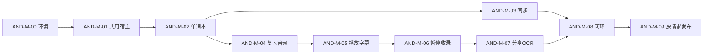

# SubtitleVocabularyList Android 开发计划

| 项目 | 内容 |
| --- | --- |
| 文档编号 | DOC-PLAN-ANDROID-001 |
| 文档版本 | 0.5 |
| 更新日期 | 2026-10-22 |
| 状态 | 0.22.0 本机功能已完成相应正常路径，AND-M-03 完整同步／剧集共享与 AND-M-08 网络部分按用户安排后置；不是完整 P0 验收或发布 |
| 需求基线 | [Android PRD](../requirements/android-PRD.md) 的 P0；P1 为后续候选，不自动纳入 |
| 设计依据 | [架构与复用设计](../design/android-architecture.md)、[开发指南](../development/android-development.md) |
| 验收依据 | Android PRD 的 AND-AC-01 至 AND-AC-12，各阶段只取与当次交付直接相关的最少正常路径 |

## 1 当前状态与计划原则

用户已认可 Android PRD，并要求最大程度复用桌面底层、降低维护成本。已完成固定工具链安装、Android 工程初始化、共享命令抽取和手机单词本界面接入，Windows／Android 原生编译及前端类型检查通过。用户开启 Windows 开发者模式后已完成完整 Android debug 构建，离线词库资源与 Android 安装逻辑已接入；用户解决 USB 安装限制后，已实际安装并通过手机离线查词、三类收录、合并与编辑；升级重开、旧例句与编辑保持及键盘适配现已通过。共享同步已接入，真实请求经用户调整网络后已批准手机；0.19.0 本机复习与生成语音正常流程已通过，0.20.0–0.22.0 本地媒体、字幕、可见计时、点词、分享和 OCR 已取得对应正常路径结果。实际证据见 [Android 验证记录](../testing/android-results.md)。

采用一套 Rust 业务核心、同一数据迁移与同步协议，Tauri／React 共用逻辑，Android 原生适配集中维护。先打通单词本；按用户最新安排后置同步联调，先补复习、观看和采集；所有 P0 完成后形成首版。按依赖和具体交付门槛推进，不承诺未经验证的完成日期或以文件数量表示完成度。

## 2 阶段、依赖和交付门槛

| 阶段 | 主要工作和预期改动位置 | 依赖 | 最少完成证据 | 当前状态 |
| --- | --- | --- | --- | --- |
| AND-M-00 环境与工具链 | 复用现有 Studio／E 盘 SDK，补所需 NDK、命令行工具与 arm64 Rust 目标；锁 JDK／Gradle／SDK；新增项目会话配置和 android:check | 本文和设计 | 只读检查清楚显示实际路径、固定版本和目标；缺项处理后进入初始化，不能以 Studio 已安装代替 | 工具链检查与 debug 构建通过，Windows 开发者模式已生效 |
| AND-M-01 共用宿主与 Android 工程 | 调整 Cargo 特性、build.rs／lib.rs、平台配置；抽共享 commands／DTO／类型导出；生成受控 Android 工程和插件壳；实现能力快照与开发入口 | AND-M-00 | Android debug 开发启动能调用 Rust 并取得能力／任务快照；Windows 共用宿主能编译并启动一次正常入口；类型生成仍只有一套 | 手机共享命令、升级冷启动和初始化等待修复通过 |
| AND-M-02 单词本与离线收录 | 复用 Store／迁移／vocabulary／底库；手机导航、列表详情、搜索、编辑、手动草稿与合并；Android 私有目录和资源安装 | AND-M-01 | 三类词条录入、同词追加例句、编辑和正常重开保持；底库查词离线可用，已有历史保留；AND-AC-01、02 的本地部分 | 手机离线查询、三类录入、合并、编辑及升级重开保持通过 |
| AND-M-03 真实账号与完整同步 | 提取 site_connection／sync_http／sync_transport 共用路径，接 Keystore、浏览器批准、媒体保存及冲突页；前台可选自动同步／移动流量提示 | AND-M-02 | 真实批准手机；Windows→服务器→手机取得完整资料，手机修改回传，原声及历史关联正确；一次正常重复交换和冲突选择；AND-AC-09、10 | 0.18.0 已接共享代码、Keystore、批准／冲突页、归属确认和自动触发；原声等待不计费网络。Keystore 存读和浏览器打开已运行；用户调整网络后真实批准与手机账号确认通过，完整资料闭环待完成 |
| AND-M-04 复习、原声与易忘词 | 复用 reviews／review_policy，Android 音频播放、离线英语声音、音频焦点、判分修正和专项；共用媒体播放入口 | AND-M-02 | 离线完成词义／听力／专项、修正、重开保持；同步回传后置；AND-AC-07、08 | 0.19.0 已通过手机离线词义／生成语音听力、专项、修正及重开；视频原声截取留在 M-05，完整同步后置 |
| AND-M-05 播放与字幕 | Android Media3 PlayerView／控制／列表；MediaRef／URI 授权；共享进度、文本字幕解析、内封 cue 索引与中英对齐；先完成原声导出接口 | AND-M-01、02、04 | 一个 MP4 和一个声明的 MKV 正常样本可播放、选轨、倍速、定位、切集及重开；可靠文本字幕和所选音轨片段可取得，不以普通视频播放代替学习媒体接口；AND-AC-04 | 0.20.0 已通过手机 MP4／MKV、内外中英文本字幕、定位／速度、独立原声导出／统一收录与重开位置正常路径；证据见专项记录 |
| AND-M-06 暂停理解与统一收录 | 共享 watch／DisplayClock、当前原文／中文、真实显示确认、按词查询、自动／手动收录与片段保存；原生面板与 React 布局 | AND-M-05 | 有效译文显示后 5 秒保存整句，提前继续不保存，同源再次暂停不重复；手动词语与独立原声可复习／同步；AND-AC-05、06 的文字／片段部分 | 0.21.0 手机可见计时、提前继续、自动整句／原声、同句回执和离线点词收录已通过；帧 OCR 与人工区间续在 M-07 |
| AND-M-07 系统分享与离线 OCR | Intent 冷／热启动同路、草稿队列、图片授权与裁剪；Tesseract 固定源码／英语资源的 NDK 构建和 Rust 封装；帧 OCR、人工区间；可选服务设置适配 | AND-M-02、05、06 | 实际来源应用分享文字及字幕图到统一收录；离线 OCR 可纠错，播放器帧可人工核对／试听收录，旧草稿保持；AND-AC-02、03、06 剩余部分 | 0.22.0 文件管理器图片分享、笔记文字分享、离线裁剪／纠错／合并、实际暂停帧与人工原声试听收录、草稿队列重开通过；可选服务复用显式在线查询，未配置远端模型 |
| AND-M-08 首版闭环收尾 | 必要任务／设置、前后台／旋转与资料保持、离线资源状态、剩余需求对照与使用说明；修复本阶段实际发现的问题 | AND-M-03、04、06、07 | 执行 AND-AC-11 并补齐前阶段尚缺的正常闭环；复用已有证据，不重跑已通过场景或扩大矩阵；P0 各需求均有对应实际结果／明确用户处置 | 0.22.0 停止／音量／连播开关、学习中文偏移、资源／任务状态和前后台保持暂停已通过；内嵌 debug 版停止电脑服务／USB 转发后冷启动通过；同步恢复和剧集资料共享仍后置 |
| AND-M-09 手动发布交付 | 用户要求发布时才签名／打包，提供资源与匹配源码／条款／摘要、安装升级说明 | AND-M-08＋用户明确打包／发布要求 | 实际产物、版本、必要资源及用户指定安装路径的结果；与开发版验证分开 | 条件阶段，未授权执行发布 |

AND-M-09 不阻塞开发代码及 P0 功能的日常交付。实施中每个逻辑交付验证后提交推送当前分支，版本按项目规则处理；不把多个中间编辑当成多次版本交付，不自动创建标签或 PR。

## 3 依赖与关键顺序

先修共用宿主，避免手机项目复制现有业务以绕过条件编译。真实批准已通过，完整资料往返和新增 AND-FR-22 剧集资料共享按用户安排后置，不阻塞其他离线阶段；播放阶段先拿到文本 cue、视频帧入口和原声导出能力，再接学习流程。Tesseract 构建与分享入口按实际需要落地，不单独开发一个长期保留的演示 App。

## 4 需求与验收追溯

| P0 需求 | 主阶段 | 主要场景／完成依据 |
| --- | --- | --- |
| AND-FR-01 单词本 | AND-M-02 | AND-AC-01 |
| AND-FR-02 手动查询／收录 | AND-M-02、07 | AND-AC-02 |
| AND-FR-03 合并与保存 | AND-M-02、03、06、07 | AND-AC-01、02、10，复用同一核心 |
| AND-FR-04 原声／英语语音 | AND-M-04、05 | AND-AC-07 |
| AND-FR-05 底库／可选查询 | AND-M-02、07 | AND-AC-02；可选服务实际可用范围单记 |
| AND-FR-06 系统文字输入 | AND-M-07 | AND-AC-02，实际来源应用 |
| AND-FR-07 图片 OCR | AND-M-07 | AND-AC-03 |
| AND-FR-08 视频／字幕 | AND-M-05 | AND-AC-04 |
| AND-FR-09 播放／进度 | AND-M-05、08 | AND-AC-04、11 |
| AND-FR-10 暂停／帧 OCR | AND-M-06、07 | AND-AC-05、AND-AC-06 |
| AND-FR-11 视频收录 | AND-M-06、07 | AND-AC-05、06 |
| AND-FR-12 主动测验 | AND-M-04 | AND-AC-08 |
| AND-FR-13 易忘词 | AND-M-04 | AND-AC-08 |
| AND-FR-14 完整同步 | AND-M-03、08 | AND-AC-09、AND-AC-10、AND-AC-11 |
| AND-FR-15 账号与设备 | AND-M-03 | AND-AC-09，真实用户批准 |
| AND-FR-22 已准备剧集资料共享 | AND-M-03、05、08 | AND-AC-12；独立资料契约与服务器扩展待实施，真实联调后置 |
| AND-FR-16 任务／设置 | 各阶段、AND-M-08 | AND-AC-04、08、11，已存资料与未完成状态可见 |
| AND-NFR-01 离线 | AND-M-02、04、07、08 | AND-AC-03、07、08，资源就绪后的正常离线闭环 |
| AND-NFR-02 保存 | AND-M-02、03、08 | AND-AC-01、08、11，保存后重开／正常生命周期恢复 |
| AND-NFR-03 手机布局 | AND-M-02、05、06、08 | 实际设备的输入、横屏观看和返回操作 |
| AND-NFR-04 前台与播放 | AND-M-05、06 | 正常播放不等待学习任务，未要求压力或性能专项 |
| AND-NFR-05 权限／联网 | AND-M-03、07、08 | 显式授权入口、手动离线、移动流量提示正常操作 |
| AND-NFR-06 多端兼容 | AND-M-01、03 | 唯一类型与核心，AND-AC-09、10 |
| AND-NFR-07 资源／交付 | AND-M-00、01、07、09 | 固定资源清单、版本一致性；手动发布时再检查发布材料 |

P1 的 AND-FR-17 至 AND-FR-21 继续保留在 PRD；不为其预先实现课程同步、题库管理、插件扩展或整季 AI。后续纳入时另列阶段和验收，不复用本计划的完成标记。

## 5 降低维护成本的完成约束

| 领域 | 完成判定 |
| --- | --- |
| 业务代码 | Android 确认保存走同一 Application／Store；无 Kotlin SQL、第二份 normalize／merge、复习计算或复制的 sync_http |
| 类型与协议 | Rust 声明生成 TypeScript，Kotlin 仅含必要平台 DTO；原协议文件及迁移唯一维护 |
| 平台条件 | Windows 专用依赖集中留平台层，共用函数不靠整模块 Windows cfg 遮住；不创建大量空实现来“骗过”编译 |
| 设置 | 手机隐藏不适用的快捷键、托盘、工具路径；共享设置值和平台偏好有明确归属，保存手机设置不清除已有其他字段 |
| 媒体 | Media3 负责 Android 解码，Tesseract 源码／资源固定；不创建第二套观剧收录时钟，不让 native View 阻断学习面板 |
| 文档与产物 | 实现一阶段更新当前结果、限制及对应文档；不累计无用原型、临时 APK 或空白验证文件 |

## 6 最低验证与证据记录

每个阶段只执行表中当次需要的正常路径，达成后立即交付。抽取共享代码时增加一次与改动相关的 Windows 正常入口确认，范围限于证明既有功能仍可运行。后续改动没有触及相同路径时，复用已有证据，不为追求数量重跑。

真实采集要记录来源应用，媒体要记录素材类型／轨道／区间及实际输出，同步要记录真实设备和往返资料关联；日志和文档不包含令牌、个人词库原文或影视片段。Android 实现开始后按实际阶段维护 `docs/testing/android-results.md`，当前不创建没有执行结果的占位记录。

负面／故障注入、压力、长时间、扩大回归及兼容矩阵测试均不由本计划自动授权。若确有必要，先向用户说明具体目标和预期成本，得到明确同意后再做。用户明确要求的验收范围按已授权范围执行，不反复索要同一项确认。

## 7 待验证风险与处置位置

| 编号 | 风险 | 解决所在阶段 |
| --- | --- | --- |
| AND-RISK-01 | 当前默认 desktop 特性、类型导出与窗口命令耦合 Windows，直接 Android 初始化可能不能编译 | AND-M-01 先修条件与唯一类型入口，保留桌面用户命令 |
| AND-RISK-02 | JDK 25／生成 Gradle、双 SDK 及缺少 NDK 导致环境混用 | AND-M-00 锁定会话与完整路径，不修改其他项目默认环境 |
| AND-RISK-03 | content URI 不能按普通文件路径处理，授权和轨道标识重开后可能变化 | AND-M-02／05 用 MediaRef、持久授权和稳定轨道映射 |
| AND-RISK-04 | 能播视频但拿不到可靠 cue、帧或所选音轨原声，不能完成学习闭环 | AND-M-05 先落实媒体接口，AND-M-06 才接入自动收录 |
| AND-RISK-05 | 原生播放器遮挡 WebView，显示确认与倒计时不一致 | AND-M-05／06 处理视图区域及真实显示回执，共用 Rust 时钟 |
| AND-RISK-06 | Tesseract 及依赖 NDK 构建、英语资源与 Native 页大小 | AND-M-07 固定源码／配方与最少设备 OCR；异常据实处理，不默默改用在线识别 |
| AND-RISK-07 | 手机真实授权或媒体往返与桌面契约不一致 | AND-M-03 使用真实站点验证，不以端点 ack 或模拟凭据代替 |

## 8 修订记录

| 版本 | 日期 | 内容 |
| --- | --- | --- |
| 0.1 | 2026-10-22 | 建立环境、共享宿主、单词本、完整同步、复习、播放学习、分享 OCR 及条件发布阶段，列出源码复用、需求验收追溯与最低验证约束 |
| 0.2 | 2026-10-22 | 开始 Android 实施，记录工具链、共享宿主、手机词库接入及实际部署权限边界 |

| 0.4 | 2026-10-22 | 按用户安排后置同步和新增剧集资料共享联调，解除复习对同步的依赖，优先离线开发 |

| 0.5 | 2026-10-22 | 记录 0.22.0 分享／离线 OCR 与本机收尾结果，保留网络同步与剧集资料共享的后置阶段 |
